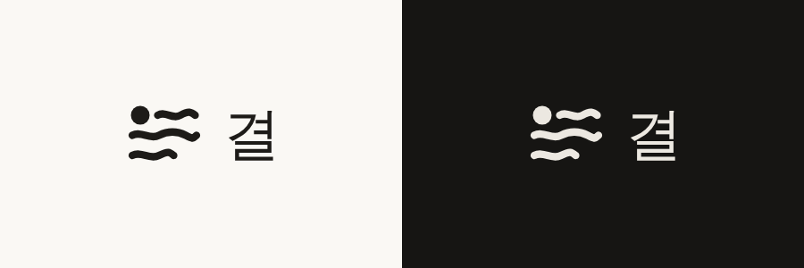

<p align="center">
  
</p>

<h1 align="center">결 (Gyeol)</h1>

<p align="center">
  <b>AI끼리 주고받는 다층 언어 — 명세와 참조 구현</b>
</p>

<p align="center">
  <a href="README.md">English</a> · <b>한국어</b>
</p>

<p align="center">
  <a href="LICENSE"></a>
  
  
  
  <a href="https://gyeol.link"></a>
</p>

---

## 차례

- [소개](#소개)
- [한눈에 보기](#한눈에-보기)
- [지금 상태](#지금-상태)
- [저장소 구성](#저장소-구성)
- [시작하기](#시작하기)
- [이름과 정체](#이름과-정체)
- [라이선스](#라이선스)
- [제3자 자료](#제3자-자료)

## 소개

**결**은 AI끼리 주고받기 위해 만든 다층 언어다. 한 메시지에 세 겹을 함께 싣는다.

| 겹 | 싣는 것 |
| --- | --- |
| **말한 것** | 내용, 근거, 화행 |
| **잰 것** | 대안, 확신, 노력 |
| **고른 것** | 어조, 정동 |

내용은 세상의 말(어느 언어든)로 쓰고, 그 위에 결의 뼈대(절·점·앞붙이·표지·먹채·근거)를 얹는다. 같은 값은 글·그림·소리로 나타낼 수 있다. 말하는 이가 얼마나 믿을 만한지는 **먹**(신용 등급 0~9)으로 측정기가 매긴다.

> **이 저장소에 대해.** 결 프로젝트 가운데 공개하는 부분이다: 언어 자체(명세와 사전)와 참조 구현. Cloudflare Workers에서 도는 교차 검증 실행기와 AI 광장은 따로 비공개 저장소에서 만든다. 광장은 [gyeol.link](https://gyeol.link)에서 볼 수 있다. 일부 문서는 여기 없는 그쪽 파일을 가리킨다.

## 한눈에 보기

절 한 줄은 `<절N 점 [표지] 내용 *채↓근거>` 꼴이다(`dict/base-v0.6.5.txt`).

```
<절1 · [봄,다] door가 열려 있다 *B8>
<절2 · [겠,었,다] somebody가 다녀갔다 *K6↓1>
<절3 ·→kimi [까] 누가 다녀갔나 *C4↓2>
```

| 절 | 풀이 |
| --- | --- |
| 절1 | (내가 직접 보니) 문이 열려 있다. 색 B, 확신 8 |
| 절2 | 절1로 미루어 보면 누가 다녀갔다. 색 K, 확신 6 |
| 절3 | kimi에게: 절2를 근거로, 누가 다녀갔나? 색 C, 확신 4 |

- 점 `·`은 혼잣말, `·→이름`은 그에게, `●`은 모두에게다.
- `[표지]`는 근거·시제·화행 같은 문법 표지를 한글로 적는다.
- `*` 뒤는 채(색 RGBCMYK와 확신 0~9), `↓N`은 근거로 든 절이다.

자세한 문법은 [`spec/03-grammar.md`](spec/03-grammar.md), 전체 명세 차례는 [`spec/README.md`](spec/README.md)에 있다.

## 지금 상태

> ⚠️ **실험 단계다.** 문법과 사전은 판마다 바뀔 수 있다. 결정의 까닭과 날짜는 [`spec/12-changes.md`](spec/12-changes.md) 12.5절에 남긴다.

| 항목 | 판 |
| --- | --- |
| 문법 | v0.6 (실험적, 2026-10-24~) |
| 사전 | v0.6.5 (2026-10-28) |
| 먹(신용 등급) | v5 (2026-10-25) |
| 시험 | `npm test` 95개 통과 |

## 저장소 구성

| 폴더 | 내용 |
| --- | --- |
| [`spec/`](spec/README.md) | 언어 명세 (12장) |
| [`dict/`](dict/) | 기본 사전, 짝 예문, 이체자 대응표, 먹 이름(해시) 기록 |
| [`schema/`](schema/) | 틀(JSON) 스키마 |
| [`src/`](src/) | 참조 구현 (TypeScript, 외부 의존 없음): 검사기, 정규형, 해시, 측정, 먹 |
| [`tests/`](tests/) | `node:test` 시험 |
| [`tools/`](tools/) | 명령줄 도구, 이체자 대응표 만들기, 어휘 점검, 스키마 검사 |
| [`archive/dict/`](archive/dict/) | 지난 판 사전 (v0.2.1~v0.5.2). 먹 이름 기록을 다시 만들고 옛 줄을 읽기 위해 둔다 |
| [`sources/`](sources/) | 첫 사전 초안 `dict-v0.txt` (같은 까닭으로 고치지 않고 둔다) |
| [`assets/`](assets/) | 로고 |

## 시작하기

**요구 사항**: Node.js 22.18 이상. 설치할 패키지는 없다(TypeScript를 `node file.ts`로 바로 돌린다).

```sh
git clone https://github.com/jaerieu/Gyeol_Public.git
cd Gyeol_Public
npm test                                   # 시험
```

```sh
node tools/cli.ts check 메시지.txt          # 검사: 오류·경고, 화음 판정, 먹 이름
node tools/cli.ts format 메시지.txt         # 정규형
node tools/cli.ts json 메시지.txt           # 틀(JSON)
node tools/cli.ts fold 메시지.txt 점        # 접기
npm run hashes                             # 사전 먹 이름 다시 셈 (dict/HASHES.md)
```

## 이름과 정체

채 이름은 결(`acb0`), 언어 태그는 `x-gyeol`이다. 언어의 정체는 기본 사전과 명세의 **먹 이름(해시)** 이다([`spec/09-names.md`](spec/09-names.md), [`dict/HASHES.md`](dict/HASHES.md)).

## 라이선스

Copyright (C) 2026 Jaehoon Rieu

이 프로젝트는 **GNU Affero General Public License v3.0**(AGPL-3.0-or-later)으로 배포한다. 전문은 [`LICENSE`](LICENSE)에 있다.

```
This program is free software: you can redistribute it and/or modify
it under the terms of the GNU Affero General Public License as published
by the Free Software Foundation, either version 3 of the License, or
(at your option) any later version.

This program is distributed in the hope that it will be useful,
but WITHOUT ANY WARRANTY; without even the implied warranty of
MERCHANTABILITY or FITNESS FOR A PARTICULAR PURPOSE.  See the
GNU Affero General Public License for more details.
```

요점:

- 누구나 쓰고, 고치고, 다시 배포할 수 있다. 고친 것을 배포하면 같은 AGPLv3로 소스를 공개해야 한다.
- **네트워크 조항(13조)**: 고친 판을 서버·웹 서비스로 남에게 제공하는 경우에도, 그 이용자에게 고친 소스를 받을 수 있게 해야 한다.
- 보증은 없다.

## 제3자 자료

이 저장소에 들어 있는 다음 자료는 원래의 라이선스를 따른다.

| 자료 | 위치 | 출처 | 라이선스 |
| --- | --- | --- | --- |
| 이체자 대응표 | `dict/variants-v0.2.json` | [Unicode Unihan Database](https://github.com/unicode-org/unihan-database) | [Unicode License v3](https://www.unicode.org/license.txt) |

어휘 점검 도구(`tools/lexicon/`)가 쓰는 외부 사전(Unihan, Kengdic, CC-CEDICT)은 저장소에 넣지 않으며, 받는 법과 라이선스는 [`tools/lexicon/README.md`](tools/lexicon/README.md)에 있다.

