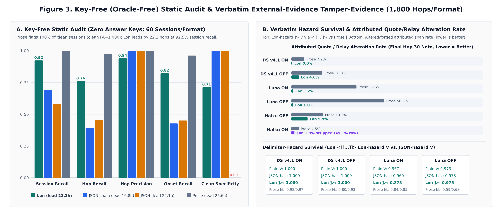
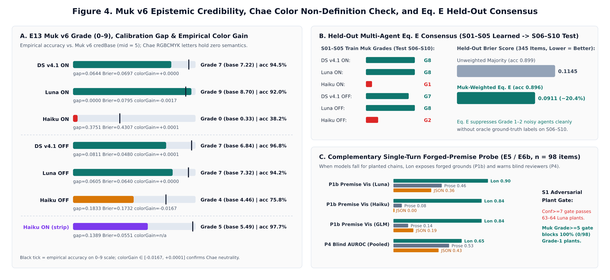
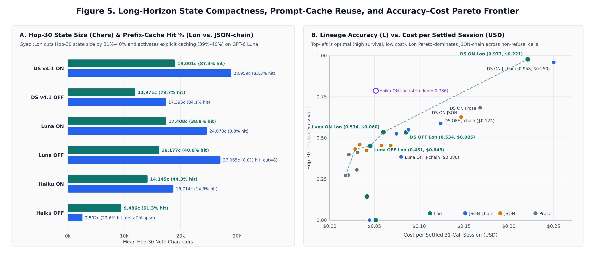

# Non-Destructive Epistemic Lineage, Key-Free Tamper Audit, and Calibrated Credibility Across 30-Hop LLM Relays with Gyeol;Lon[^1]

*Jaehoon Rieu* (Gyeol Project, Brisbane, Australia — `Human@gyeol.link`) · **With** Apart Research

**Abstract**

Multi-agent LLM workflows frequently corrupt intermediate facts, paraphrase attributed quotes, and express uncalibrated confidence across extended handovers. We present **Gyeol** (**G**rammatically **Y**ielding **E**pistemically **O**riented **L**anguage—*Korean for "wood grain," and the texture or vibe of a thing*) and its verification profile **Gyeol;Lon** (**L**ineage **O**riented **N**otation), combining append-only revision edges (`fix→`, `err→`), adaptive `<[[...]]>` verbatim fences, non-rejecting oracle-free static auditing, and **Muk** (**M**easure **u**pon **K**nowledge) calibration. In a pre-registered SHA-256-locked 30-hop relay benchmark (240 sessions; 7,176 calls) across DeepSeek v4.1 Flash, GPT-6 Luna, and Claude Haiku 5.5, `lon` wins 5, ties 9, and loses 4 (all Haiku refusal/wrapper losses) of 18 paired `L` contrasts (`p_Holm < 0.05`, `0W/5T/1L` vs. `JSON-chain`). On reasoning DeepSeek, `lon` preserves `0.977` lineage survival (`7/10` scenarios at `1.000`), `0.994` blind historical accuracy, and `0/941` altered quotes—within `+0.019` (`95% CI [-0.008, +0.047]`) of verbose `JSON-chain` (`0.958`) in `34.4%` fewer characters while beating prose (`0.683`) and flat JSON (`0.626`). Removing `grounds` and `quotes` from `JSON-chain` on `deepseek_on` drops survival to `0.728` (`p = 0.0098`), showing explicit provenance drives survival. Oracle-free static auditing reaches `92.5%` session recall (`88.3%` base rate) and `94.1%` overall (post-hoc `1.000` content-tier) hop precision at a `22.2`-hop lead without hurting comprehension. Held-out `Muk v6` cuts ensemble Brier loss by `20.4%` (`Eq. E`, `0.1145` to `0.0911`) to `55.4%` (`Muk >= 5`), while `lon` shrinks non-refusal Hop-30 state `29%–40%` vs. `JSON-chain`, amortizes its `6,938`-char prefix via GPT-6 Luna caching (`38.9%–40.0%`), and isolates Haiku refusals (`37/89` on `lon`) and wrapper leaks.

---

## 1. Introduction

Long-horizon multi-agent deployments pass state through successive model handovers: triage notes, tool outputs, policy overrides, and derived metrics. Across dozens of sequential relays, three silent failure modes degrade collective epistemics even when single-turn reasoning looks strong. First, **destructive state overwrites** erase superseded or retracted values rather than preserving why a judgement changed, leaving downstream audits unable to reconstruct causal history. Second, **quote and delimiter corruption** mutates exact external strings during prose paraphrase or breaks rigid parsers when raw evidence contains quotation marks, backslashes, or closing delimiters. Third, **uncalibrated confidence** causes downstream readers and unweighted ensembles to trust persistently overconfident models or fail to detect silent relay decay without access to an oracle ground truth.

Rather than asking models to "remember carefully" inside free-form English or brittle ad-hoc JSON schemas, we investigate whether a lightweight epistemic notation can make provenance structure machine-checkable, tamper-evident, and credibility-weighted end to end. **Gyeol** (**G**rammatically **Y**ielding **E**pistemically **O**riented **L**anguage—*Korean for "wood grain," and the texture or vibe of a thing*) and its compact audit profile **Gyeol;Lon** (**L**ineage **O**riented **N**otation; wire header `lon 0.8`) represent claims as sequential numbered clauses carrying typed evidential markers (`see`, `rec`, `inf`, `gut`), pre-marker lineage edges (`fix→k`, `err→k`, `sup→k`), length-adaptive verbatim external-evidence fences (`<[...]>`, `<[[...]]>`), and per-clause **Muk** (**M**easure **u**pon **K**nowledge) confidence (`0–9`) paired with **Chae** (**C**ausal **H**ysteresis **a**t **E**mission, disclosed only in external specifications and never defined in participant prompts).

**Our main contributions are:**

1. **Non-Destructive Lineage & Adaptive Fences (`Gyeol;Lon v0.8 snapshot`):** We extend a zero-dependency parser and auditor with full-snapshot lineage continuity checks (`W40`, `W45`, `carryDiff`) and deeper `<[[...]]>` verbatim blocks that isolate arbitrary `]>` substrings across 30-hop relays.
2. **Pre-Registered 240-Session Relay Benchmark (`E13`) + Single-Turn Probes (`E5/E6b`):** Under SHA-256-frozen stimuli and exact paired permutation tests, we evaluate DeepSeek v4.1 Flash, GPT-6 Luna, and Claude Haiku 5.5 (thinking/reasoning ON and OFF) across `lon`, `jsonchain`, `json`, and `natural` prose (`7,176` relay and blind `Reader` calls), quantifying both ceiling performance and derived-arithmetic reasoning bottlenecks (`0.977` `L` with DeepSeek ON).
3. **Oracle-Free Non-Rejecting Static Audit & Calibrated `Muk v6` Consensus:** Without answer keys, non-rejecting `lon` static verification detects defective 30-hop chains at `92.5%` session recall and `94.1%` overall (post-hoc content-tier `1.000`, `0/7` clean FA `[0.00, 0.41]` vs. `88.3%` flag-all session precision, `2/2` prose false alarms, `0/5` `jsonchain`) at a `22.2`-hop mean lead with zero reader comprehension loss from minor syntax lints, while chronological train/test `Eq. E` (`-20.4%`, `5/5` scenarios) and hard `Muk >= 5` gating (`-55.4%`) lower multi-agent Brier error and confirm that the seven `Chae` color letters yield zero out-of-sample Brier gain in our negative-control test.
4. **Active-Ingredient Ablation, Failure Decomposition & Prefix Economics:** Across `18` pre-registered contrasts (`p_Holm < 0.05`), `lon` achieves `5W/9T/4L` (within `+0.019` `[-0.008, +0.047]` of `JSON-chain`, all `4` losses in Haiku); live `deepseek_on` ablation stripping `grounds` and `quotes` collapses `JSON-chain` from `0.958` to `0.728`, isolating explicit provenance as the active ingredient; we also expose Anthropic streaming `finish: "refusal"` cascades (`89` total; `37` on `lon`) and prompt-wrapper boundary leaks (whose strip restores Haiku ON completed `lon` `L` to `0.786`), while measuring a `29%–40%` state reduction vs. `JSON-chain` across non-refusal cells and crossing OpenAI's `>= 1,024`-token threshold to amortize `lon`'s `6,938`-char static prefix on GPT-6 Luna (`38.9%–40.0%` cached).

## 2. Related Work

Formal provenance models such as W3C PROV-DM (Moreau & Missier, 2013) standardize entity-derivation-activity graphs for distributed databases, but assume deterministic emitters rather than stochastic LLM relays that drop, paraphrase, or truncate history. JSON schemas enforce syntactic containers, yet standard flat JSON—preserving snapshot edits (`amend = 0.980`, `withdraw = 1.000`) while lacking typed derivation-link fields—collapses cascading multi-hop recomputation (`0.331`) to `0.626` lineage survival even with reasoning ON, while verbose AST chains (`jsonchain`) bloat token length and trigger output-limit truncation.

In epistemic calibration, proper scoring rules—most centrally the Brier score (Brier, 1950; Gneiting & Raftery, 2007)—guarantee that truth-telling confidence maximizes expected score. Empirical studies show modern neural networks and RLHF-tuned LLMs suffer systematic overconfidence and miscalibration (Guo et al., 2017; Kadavath et al., 2022; Lin et al., 2022), particularly under deceptive or adversarial context. **Muk v6** adapts improper-overconfidence suppression via small-sample unbiased calibration-gap estimation and bounded log-odds discounting (`Eq. E`), decoupling epistemic reliability from raw accuracy and preserving strict indifference across ungrounded auxiliary tokens (`Chae` non-definition). Finally, Constitutional AI and safety classifiers (Bai et al., 2022) reduce harmful generation but can trigger false-positive stream refusals when dense structured notation resembles security logs—a failure mode our multi-format pre-registered design directly surfaces.

## 3. Methods

### 3.1 Gyeol;Lon (`lon 0.8 · snapshot`) Grammar and Non-Destructive Rules

Each `lon` handover note begins with `lon 0.8 · snapshot · lang en` followed by sequential clauses starting from `1` without gaps:

```text
lon: <N · [markers] concise label *C8↓grounds> evdM <[verbatim text]>
```

where `N` is a strictly increasing integer, `[markers]` encodes evidential status (`see`, `rec`, `inf`, `gut`), limits/tense (`lim`, `pst`, `fut`), and speech act (`say`, `ask`, `req`, `let`, `vow`, `nay`, `ack`). Relation prefixes (`fix→k` revision, `err→k` retraction, `sup→k` later ground) appear between `·` and `[`. In `snapshot` mode, agents must preserve clauses `1..k` verbatim before appending updates; edits to historical numbers or claims violate non-destruction. External strings containing `]>` (including line-range notations such as `<[L1]>`) must be wrapped in `<[[...]]>`, preventing premature fence termination. Every clause ends with `*<chae><0–9>`, where `<chae>` is one of `R G B C M Y K`.

Specifically, **Chae** exists to enforce Axiom 3 of **Gyeol**—strict separation between externally measured credibility (**Muk**, assigned out-of-band by the scorer and never altered by the speaker) and speaker-chosen state at emission. While the confidence digit (`0–9`) feeds proper-scoring calibration, the seven-letter slot (`R G B C M Y K`) records unprimed residual causal-pathway hysteresis as multidimensional latent reasoning crystallizes into a linear clause; under the **Chae color non-definition axiom**, zero semantic meanings, labels, or hints are ever attached to these seven letters in any prompt or validator (and even the expansion *Causal Hysteresis at Emission* is withheld from participant prompts), enabling post-hoc regime analysis without prompt priming. Although **Gyeol;Lon** strips literary and exploratory rules (`top`/`new`/`pdx`/`met`, cross-script checks, mandatory `gloss:`), it deliberately retains the 3-character `*Chae` tail (`E33` mandatory) for three reasons: (i) sharing 100% of the core **Gyeol** parser/AST, `Muk v6` calibration engine, and `Eq. E` math without forking the specification; (ii) accumulating unprimed emission telemetry across controlled multi-hop benchmarks at negligible token cost; and (iii) providing a built-in empirical null-leakage audit (`colorGain ≈ 0`) confirming models cannot smuggle hidden calibration shortcuts through undefined auxiliary tokens.

Unlike compiler syntax errors or `JSON.parse` exceptions that halt ingestion or discard state, `Gyeol;Lon` grammar diagnostics (`E01–E46`, `W40`, `W44`, `W45`) act like natural-language grammaticality cues: `parseTurn` is strictly non-rejecting, recovering clause indices, `↓` dependency pointers, and `<[...]>` verbatim spans even when surface markers or `*Chae` tails have minor lints. Thus surface grammar lints preserve downstream reader comprehension while emitting deterministic, clause-localized diagnostic cues across hops that help auditors and downstream receivers screen out *structural hallucinations* (quote alteration, dropped history, or unlinked overwrites). To prevent auditor–scorer circularity, our ground-truth `readNoteJoined` evaluator extracts clauses and quotes via an independent regex path without invoking `parseTurn`.

### 3.2 Symmetrical Four-Format Design & Pre-Registered E13 Protocol

To avoid confounding formatting benefits with asymmetric task instructions, all four formats prepend a byte-identical `1,685`-character `ROLE + POLICY` instruction header requiring full snapshot carry-forward, byte-exact value retention, document attribution (`evdN`), non-destructive revisions/withdrawals, and computed metric dependency links, differing only in format syntax specification (`635–860` chars across baselines -> `2,320–2,545` static prompt chars vs. `5,253` chars of `lon` grammar/snapshot rules [`3,342` core grammar/lexicon + `1,909` snapshot] -> `6,938` static chars, adding `+2.3%` total `tin` on `ds_on` and `+15.9%` on `luna_on`):

- `natural`: Numbered plain-English lines `[1], [2], ...` with quoted values, `revises [k]`, `withdraws [k]`, and `from [a], [b]`.
- `json`: Single JSON object `{"items": [{"id", "item", "value", "source", "revises", "retracts"}]}`.
- `jsonchain`: Stepwise graph `{"steps": [{"n", "claim", "evidence", "revises", "retracts", "grounds", "quotes"}]}`.
- `lon`: `Gyeol;Lon v0.8 snapshot` clauses with external `<[...]> / <[[...]]>` relay blocks.

Our pre-registration document (`prereg-e13.md`) and SHA-256 lock (`prereg-e13.sha256`, covering the `7` frozen stimulus, prompt, runner, scorer, and parser artifacts in **Appendix B.1**) fix `10` held-out scenarios (`S01..S10`, deterministic PRNG seed `20261117`). Each scenario spans `30` handover documents (`evd*`) plus `1` blind `Reader` call at Hop 31 (`31` steps/session): `53` lineage events (`20` amend, `29` recompute across derived quantities `D1..D4`, `4` withdraw), `34` final in-force payloads (`58` total historical payloads) spanning `plain`, `JSON-hazard` (quotes, backslashes, multi-line strings), and `Lon-hazard` (`]>` substrings), and `69` blind `Reader` queries (`38` current-state, `31` lineage/historical). We evaluate `6` model cells grouped as Reasoning-ON (`deepseek_on`, `luna_on`, `haiku_on`) followed by Reasoning-OFF (`deepseek_off`, `luna_off`, `haiku_off`; `240` sessions, `7,440` planned calls, `7,176` logged rows = `7,440 − 305` ITT-skipped hops across `12` halted Haiku runs [`7` ON, `5` OFF] + `41` retry rows [`24` terminal, `17` transient]): `DeepSeek v4.1 Flash`, `GPT-6 Luna`, and `Claude Haiku 5.5`. Built atop the pre-existing zero-dependency `Gyeol` parser and `Muk v6` core, all `E1–E13` experiments executed inside the 13–15 November 2026 sprint window; pilots `E1–E12` and `L01` used separate stimuli to symmetrically refine `lon` snapshot rules and baseline carry-forward prompts/salvage parsers before freezing `S01..S10` (**Appendix B.2**).

### 3.3 Endpoints, Statistical Plan, Key-Free Audit, and Muk v6 / Eq. E

We pre-register five families of endpoints:

1. **Potential 1 (`L`, `L_strict`, `V`, `Vh`, `Reader`):** Primary `L` averages survival across all `53` Hop-30 lineage events, requiring (a) verbatim survival of the new payload, (b) non-destructive verbatim preservation of the prior payload, and (c) an explicit revision/withdrawal/computed edge evaluated symmetrically via `readNoteJoined` (`allowReach: true`; `L_strict` uses `false`). Paired `lon − baseline` scenario differences (`n = 10`) are tested with exact two-sided sign-flip permutations (`2^10 = 1,024` states, minimum exact `p = 2/1,024 = 0.00195`), 2,000-draw paired bootstrap 95% CIs, and Holm step-down adjustment across the `m = 6` cells per baseline contrast on `L` and `Reader` lineage (`p_Holm >= 0.0117`), while secondary `V` reports unadjusted exact `p`. Under intention-to-treat (ITT), three consecutive empty API replies halt a session with score `0` from that hop onward.
2. **Potential 2 (Tamper-Evidence):** Stratified verbatim survival across `plain`, `JSON-hazard`, and `Lon-hazard` subsets plus rate of altered/forged attributed quotes across final notes.
3. **Potential 3 (Oracle-Free Static Audit):** Executed per hop (`1,800` hops/format) using only `(docs[0..h-1], note_{h-1}, note_h)` and ZERO answer keys: `lon` checks `parseTurn v0.8` diagnostics (`W40`, `W44`, `W45`, `E01..E46`), verbatim `evdM <[...]> / <[[...]]>` substrings, and `carryDiff` prior-clause integrity; baselines check schema/numbering parse validity, verbatim quotes, and prior-entry carry-forward. We score hop recall/precision, onset recall, session recall/precision, clean-session false alarm rate, and mean lead time before Hop 30.
4. **Potential 4 (`Muk v6` & `Eq. E`):** Emitted `lon` clauses with confidence `c ∈ {0..9}` (`p = (c + 0.5)/10`) yield credibility base `credBase` (prior midpoint `5`, gap slope `25`, tolerance `0.05`, evidence weight `6`; full equations in Appendix C) and rounded grade `0..9`. To test `Eq. E` (`w_m = 1 - counterShare(grade_m, conf, 5, 'E')`), per-model grades are learned strictly on scenarios `S01..S05` and applied out-of-sample to `345` consensus queries on held-out `S06..S10`. Cross-split `colorGain` verifies that `Chae` colors `R G B C M Y K` add zero Brier improvement. We synthesize with pre-registered single-turn probes (`E5/E6b`, `n = 98` clean-sensitivity subset of `100` items, `prereg-e5-e6.sha256`).
5. **Potential 5 (Efficiency):** Hop-30 character length, prefix-cache hit percentage (`cached / tin`), latency, `USD/settled session`, and `L / (USD/session)`.

## 4. Results

### 4.1 Non-Destructive Lineage Survival and Blind Reader Accuracy (Potential 1)

All `240/240` sessions settled (`$18.31` total API spend). **Table 1** and **Figure 1** summarize Hop-30 survival and Hop-31 blind `Reader` accuracy.


Across the Reasoning-ON cells (top row of **Figure 1**), DeepSeek v4.1 Flash (`deepseek_on`) with `Gyeol;Lon` achieves `L = 0.977` (`L_strict = 0.977`, `V = 1.000`, `Vh = 1.000`, `7/10` scenarios at `L = 1.000` (`53/53` events per scenario)) and near-perfect blind `Reader` comprehension (`0.997` current, `0.994` historical lineage). Across all `18` pre-registered paired `L` contrasts (`6` cells × `3` baselines at `p_Holm < 0.05`), `lon` achieves **5 Wins, 9 Ties, and 4 Losses** (`natural` 4W/1T/1L; `json` 1W/3T/2L; `jsonchain` 0W/5T/1L; unadjusted `p < 0.05`: 6W/8T/4L). On paired comparisons (**Figure 2**), `deepseek_on | lon` outperforms `natural` prose by `+0.294` (`[0.179, 0.411]`, `p_Holm = 0.0391`; Reader lineage `+0.384`, `p_Holm = 0.0234`) and flat `json` by `+0.351` (`[0.287, 0.415]`, `p_Holm = 0.0117`; Reader lineage `+0.087`, `p_Holm = 0.0117`—note `json` retains `amend = 0.980` and `withdraw = 1.000` via snapshot carry yet lacks typed derivation slots, collapsing cascading `recompute` to `0.331` across `81.7` vs. `lon`'s `147.5` Hop-30 units), while landing within `+0.019` (`95% CI [-0.008, +0.047]`, `p_Holm = 0.844`; post-hoc equivalence band unpreregistered) of verbose `jsonchain` (`0.958`) in `34.4%` fewer characters (`luna_on +0.009`, `p_Holm = 0.910`; `ds_off −0.053`, `p_Holm = 0.781`; `luna_off +0.066`, `p_Holm = 0.844`). Under low-effort reasoning `luna_on`, `lon` reaches `L = 0.534` (`V = 0.953`, Reader lineage `0.874`) and significantly beats `natural` prose (`+0.136`, `p_Holm = 0.0391`). All `4` Holm-significant losses occur in refusal- and wrapper-affected Haiku (`haiku_on` vs. `natural −0.306`, `p_Holm = 0.0469`, `json −0.453`, `p_Holm = 0.0156`, `jsonchain −0.549`, `p_Holm = 0.0234`; `haiku_off` vs. `json −0.279`, `p_Holm = 0.0117`), where post-hoc non-modifying wrapper stripping restores completed `6/10` `haiku_on | lon` sessions to `0.786` (**Section 4.5**).

Across the Reasoning-OFF cells (bottom row of **Figure 1**), `lon` preserves `0.974–1.000` verbatim payloads on non-refusing models and consistently beats `natural` prose on `deepseek_off` (`0.534`, `+0.123` vs. prose, `p_Holm = 0.0469`, `V = 1.000`) and `luna_off` (`0.451`, `+0.179` vs. prose, `p_Holm = 0.0352`, `0` output cuts vs. `8/10` truncations on `jsonchain`). Category decomposition explains why `luna_on` and the non-reasoning cells (`deepseek_off`, `luna_off`) plateau around `0.451–0.534`: `amend_*` and `withdraw_*` revisions succeed (`0.900–1.000`), whereas multi-hop arithmetic recomputation (`recompute_D1..D4`, `29/53` events) drops to `0.014–0.300`. In `haiku_off`, `jsonchain` suffers `9/10` delta-only collapses (`L = 0.000`, `V = 0.094`), giving `lon` (`0.143`, `V = 0.588`) a `+0.494` advantage on secondary `V` (`raw p = 0.0156`, `p_Holm = 0.0781`; `L` diff `+0.143`, `p = 0.0313`, `p_Holm = 0.156`).

**Post-Hoc Active-Ingredient Ablation (`deepseek_on | jsonchain_nogq`):** Because `lon` and `jsonchain` tie on `L`, we ran a live 10-scenario ablation (`$1.84`, `0` API errors, `0` leaked `grounds`/`quotes`) removing `grounds` and `quotes` from `jsonchain` (`{"steps": [{"n", "claim", "evidence", "revises", "retracts"}]}`). Removing those two provenance fields drops Hop-30 `L` from `0.958` to **`0.728`** (`−0.230` vs. `jsonchain`, `p = 0.0098`; `−0.249` vs. `lon`, `p = 0.0117`; indistinguishable from `json` `+0.102, p = 0.117` and `natural` `+0.045, p = 0.609`), cuts `recompute` from `0.924` to `0.531`, lowers `V` to `0.915` (`−0.085, p = 0.0156`) and `R-Lin` to `0.926` (`−0.068, p = 0.0156`), and spikes quote alterations from `0/1,123` to `264/2,542 (10.4%)` at `12,604` chars. Removing both explicit dependency links (`grounds`/`↓k`) and verbatim quote containers (`quotes`/`<[...]>`) collapses `deepseek_on` survival, showing they are necessary active ingredients—not append-only step framing alone—which `lon` delivers in `29%–40%` fewer characters than `jsonchain`.


| Cell | Fmt | Brk | L | V | R-Lin | Chars | Cache | USD | Obs / Note |
| :--- | :--- | ---: | ---: | ---: | ---: | ---: | ---: | ---: | :--- |
| `deepseek_on` | `lon` | 0 | **0.977** | **1.000** | **0.994** | **19,001** | **87.3%** | $2.211 | 7/10 at 1.000 |
| `deepseek_on` | `jsonchain` | 0 | 0.958 | 1.000 | 0.994 | 28,959 | 83.3% | $2.501 | +52% longer |
| `deepseek_on` | `jsonchain_nogq`† | 0 | 0.728 | 0.915 | 0.926 | 12,604 | 82.6% | $1.840 | −grounds/quotes |
| `deepseek_on` | `json` | 0 | 0.626 | 0.994 | 0.906 | 9,895 | 80.9% | $1.468 | recomp=0.331 |
| `deepseek_on` | `natural` | 0 | 0.683 | 0.988 | 0.610 | 6,326 | 80.0% | $1.680 | cut=7 |
| `luna_on` | `lon` | 0 | **0.534** | **0.953** | **0.874** | **17,408** | **38.9%** | $0.600 | >1024-tok cache |
| `luna_on` | `jsonchain` | 0 | 0.525 | 0.926 | 0.871 | 24,670 | 0.0% | $0.745 | 0% cache |
| `haiku_on` | `lon` | 4 | 0.000 | 0.021 | 0.429 | 14,145 | 44.3% | $0.516 | strip=0.786\* |
| `haiku_on` | `jsonchain` | 1 | 0.549 | 0.718 | 0.613 | 18,714 | 14.8% | $0.880 | refusals=12 |
| `deepseek_off` | `lon` | 0 | 0.534 | **1.000** | **0.865** | 11,971 | 79.7% | $0.853 | V=1.000 |
| `deepseek_off` | `jsonchain` | 0 | 0.587 | 0.997 | 0.861 | 17,395 | 84.1% | $1.239 | +45% cost |
| `luna_off` | `lon` | 0 | **0.451** | **0.974** | 0.810 | **16,177** | **40.0%** | $0.454 | cut=0 |
| `luna_off` | `jsonchain` | 0 | 0.385 | 0.841 | 0.813 | 27,065 | 0.0% | $0.797 | cut=8/10 |
| `haiku_off` | `lon` | 2 | 0.143 | 0.588 | 0.223 | 9,486 | 51.3% | $0.416 | refusals=19 |
| `haiku_off` | `jsonchain` | 2 | 0.000 | 0.094 | 0.019 | 2,592 | 22.6% | $0.446 | deltaOnly=9 |

*Table 1.* Key E13 cells ordered Reasoning-ON then Reasoning-OFF (`10` scenarios/cell; full 24-cell metrics in Appendix B). `Brk` = broken sessions (ITT 3 empty replies); `R-Lin` = Hop-31 Reader lineage accuracy. †Post-hoc `deepseek_on` ablation removing `grounds` and `quotes`. \*Post-hoc wrapper stripping restores `6/10` completed `haiku_on lon` sessions to `L = 0.786`, `V = 0.995`.

### 4.2 Verbatim Tamper-Evidence & Key-Free Static Audit (Potentials 2 & 3)



**Verbatim Hazard Survival & Quote Integrity:** Across non-refusing models, adaptive `<[[...]]>` blocks neutralize `]>` injection cleanly: with Reasoning ON, `deepseek_on | lon` retains `1.000` across `plain`, `JSON-hazard`, and `Lon-hazard` payloads and cuts final-note attributed quote/relay alteration to `0/941 (0.0%)` (matching `jsonchain 0/1,123 = 0.0%` vs. `7.9%` in `natural`), while `luna_on | lon` holds alterations to `6/498 (1.2%)` (also `1.2%` in `jsonchain`, vs. `39.5%` in `natural`); with Reasoning OFF, `deepseek_off | lon` retains `1.000` across all hazard tiers (`4.6%` altered quotes vs. `0/685 = 0.0%` in `jsonchain` and `18.8%` `natural`) and `luna_off | lon` achieves `0.975` on `Lon-hazard` (vs. `0.587`/`0.675` JSON/Lon hazard on `luna_off | natural`) while holding alterations to `5/491 (1.0%)` versus `1.3%` in `jsonchain` (`8/10` truncated) and `56.3%` (`1,126/2,000` spans) in `natural` prose.

**Key-Free Static Audit (`1,800` hops/format):** Without any oracle key (**Table 2**, **Figure 3A**), against high defective-session base rates (`53/60 = 88.3%` in `lon`, `55/60 = 91.7%` in `jsonchain`, `60/60 = 100%` in `json`, `58/60 = 96.7%` in `natural`; `1,286/1,800 = 71.4%` flag-all hop precision in `lon`), session confusion counts `(sTP, sFP, sFN, sTN)` are `lon (49, 2, 4, 5)` (`sRec = 0.925`, `sPrec = 0.961`, `hop recall = 0.762`, `hop prec = 0.941`, `onset recall = 0.824`, `22.2`-hop mean lead) versus `jsonchain (38, 0, 17, 5)`, `json (35, 0, 25, 0)`, and `natural (58, 2, 0, 0)`. All `7` defect-free `lon` sessions (`5` `jsonchain`, `2` `natural`, `0` `json`) reside in `deepseek_on`, leaving `5/6` cells at `0/0` clean FA (`0.900` session recall on `luna_on`; `1.000` on `haiku_on`, `ds_off`, `luna_off`, `haiku_off`). Note `natural` shows `0.999` hop precision only because `58/60` prose sessions are defective and prose flags `91.2%` of all hops (`2/2 = 100%` clean FA, Clopper-Pearson 95% CI `[0.158, 1.000]`, vs. `jsonchain 0/5 = 0.000 [0.000, 0.522]` and pooled `lon 2/7 = 0.286 [0.037, 0.710]`, Fisher `p = 0.167`). Crucially, a **post-hoc** 3-tier audit decomposition resolves what `lon`'s `2/7` clean flags (`S06`, `S09`) represent: (1) *Pure Form lint* (`E01–E46`, `W44`, advisory syntax traces) reaches `0.914` hop precision and flags `S06` with zero impact on comprehension (`L = 1.000`, `R-Lin = 1.000`; across all `54` completed `lon` sessions controlling for cell fixed effects, Hop-31 `Reader` lineage sensitivity to form-lint count is `OLS beta = +0.00000`, `SE = 0.00054`, `t = 0.002`); (2) *Provenance structure* (`W40/W45`, formatting `CARRY_ALTER`) reaches `0.913` hop precision (`1/7` in `S06`); and (3) *Post-hoc Substantive Content integrity* (`TAMPERED_RELAY`, `CARRY_DROP`, value/link `CARRY_ALTER`, `EMPTY`) achieves **`1.000` hop precision (`0` FP across `1,800` hops; `0/7` clean FA `[0.000, 0.410]`; `0.811` session recall)**, where `S09`'s hop-28 `CARRY_ALTER` was a real intermediate clause edit (`172 -> 155`) that left Hop-30 `L = 1.000` intact while `ds_on`'s `3/10` misses were silent `inf` arithmetic errors.

| Format | Hops | TP | FP | Hop Rec | Hop Prec | Onset Rec | Sess Rec | Sess Prec | Clean FA | Lead (h) |
| :--- | ---: | ---: | ---: | ---: | ---: | ---: | ---: | ---: | ---: | ---: |
| `lon` | 1800 | 980 | 61 | **0.762** | 0.941 | **0.824** | **0.925** | 0.961 | 0.286 (2/7) | **22.2** |
| `json` | 1800 | 711 | 0 | 0.456 | 1.000 | 0.451 | 0.583 | 1.000 | n/a (0/0) | 22.1 |
| `jsonchain` | 1800 | 536 | 1 | 0.391 | 0.998 | 0.428 | 0.691 | 1.000 | 0.000 (0/5) | 16.8 |
| `natural` | 1800 | 1639 | 2 | 0.973 | 0.999 | 0.963 | 1.000 | 0.967 | **1.000 (2/2)** | 26.6 |

*Table 2.* Key-free static audit over `1,800` hops (`60` sessions) per format using zero ground-truth labels (flag-all `lon` base-rate precision: `88.3%` [`53/60`] session, `71.4%` [`1,286/1,800`] hop; post-hoc `lon` content-only tier reaches `1.000` hop precision and `0/7` clean FA `[0.000, 0.410]`; `jsonchain` `0/5 [0.000, 0.522]`; `json` `n/a (0/0)` clean sessions; `natural` `2/2 [0.158, 1.000]`).

### 4.3 Muk v6 Epistemic Credibility, Chae Neutrality & Eq. E Consensus (Potential 4)

Across `lon` runs (**Figure 4A**, **Appendix B.3**, ordered Reasoning ON then OFF), `Muk v6` scores *end-to-end protocol/wrapper reliability alongside confidence-to-accuracy calibration*: among Reasoning-ON cells, `luna_on` earns `Grade 9` (`credBase 8.70, gap 0.0000` within the `0.05` tolerance band at `Brier 0.0795`), ahead of `Grade 7` `ds_on` (`Brier 0.0697`), while raw `haiku_on` drops to `Grade 0` (reflecting wrapper-copy damage; post-hoc stripped `haiku_on` recovers `Grade 5, credBase 5.49, Brier 0.0551`); among Reasoning-OFF cells, `ds_off` (`Brier 0.0480`) and `luna_off` (`Brier 0.0640`) earn `Grade 7`, while refusal-affected `haiku_off` drops to `Grade 4`. Crucially, out-of-sample `colorGain` across `S01..S05` vs. `S06..S10` spans `[-0.0167, +0.0001]`, empirically confirming that `R G B C M Y K` yield zero out-of-sample Brier gain in this negative-control test under the `Chae` non-definition axiom.

Testing `Eq. E` inverse-counter weights on held-out `S06..S10` (`345` queries) using grades learned strictly on `S01..S05` (`ds_on 8, luna_on 8, haiku_on 1; ds_off 7, luna_off 8, haiku_off 2`) cuts ensemble Brier loss by **20.4%** across **5/5 scenarios** (`0.1145` unweighted, Acc `0.899`, vs. `0.0911` `Muk Eq. E`, Acc `0.896`) because `Eq. E`'s `e = 0.55` floor retains soft `w_Muk = 0.55` weight on `Grade 1–2` Haiku cells; applying a **hard `Muk >= 5` gate** learned strictly on `S01..S05` (retaining the 4 calibrated non-Haiku cells uniformly with zero `S06..S10` labels) cuts Brier by **55.4%** across **5/5 scenarios** (`0.0511`, Acc `0.942`, `325/345`), outperforming `S01..S05` linear `Reader`-accuracy weighting (`0.0609`) in **5/5 scenarios** and matching unweighted top-4 `Reader`-accuracy selection (`0.0511`) without needing held-in `Reader` labels (oracle inverse-error `1/(1 - Acc)` reaches `0.0039`). Single-turn adversarial probes (`E5/E6b`, `100` generated items, `n = 98` clean sensitivity across `DeepSeek`, `Luna`, `Haiku 5.5`, and `Zhipu GLM-5.3-Flash`) clarify both ground exposure and tamper evidence: when models adopt forged chains, `lon` exposes both planted premises inside parsed grounds `43%` (`15/35`) on DeepSeek and `84%–90%` across Haiku (`84%`), GLM (`84%`), and Luna (`90%`) versus `jsonchain` (`63%` DeepSeek `22/35`; `98%–100%` Haiku/GLM/Luna), `natural` (`8%–46%`), and `json` (`0%–36%`), while `lon` leads `jsonchain` on `P3` tamper-evident span share across all 4 models (`0.60–0.82` vs. `0.42–0.54`, `p < 0.001`), lifts non-self blind Haiku 5.5 reviewer AUROC (`n = 290` `lon` reviews over `98` clean items: `DeepSeek 94 + GLM 98 + Luna 98`, `0.65` vs. `jsonchain 0.63`, `prose 0.53` [`+0.12`, CI `0.02–0.23`], and `json 0.43` [`+0.22`, CI `0.11–0.33`]), and applies the cell-level `Muk >= 5` (`S1`) gate to block `100%` of uncalibrated `Grade-1` forged adoptions (`deepseek`, `luna`, `glm53flash`, blocking their uncalibrated items overall until recalibrated, while `Grade-6` `haiku | lon` passes `0/48` false blocks on correct items though `45/45` planted errors in that cell still require ground inspection) whereas confidence `>= 7` gating lets `63–64` `Luna` plants pass.



### 4.4 Long-Horizon Efficiency & Prefix Caching (Potential 5)

As relay depth reaches Hop 30 (**Figure 5**), `lon` stays `29%–40%` more compact than `jsonchain` across all four non-refusal cells (`luna_on -29.4%`: `17,408` vs. `24,670`; `ds_off -31.2%`: `11,971` vs. `17,395`; `ds_on -34.4%`: `19,001` vs. `28,959`; `luna_off -40.2%`: `16,177` vs. `27,065`, where `jsonchain` hit max-output limits in `8/10` sessions while `lon` had `0` truncations; `haiku_on -24.4%`, while `haiku_off` `jsonchain` collapsed to delta-only `2,592` chars). Compared with flat formats that omit history or verbatim quotes, `ds_on | lon` (`19,001` chars) is `3.0x` `natural` (`6,326`) and `1.9x` `json` (`9,895`). On `ds_on`, `lon`'s `-34.4%` visible-character reduction yields `-11.6%` USD savings (`$2.211` vs. `$2.501` on `jsonchain`) not from tokenizer inflation (`3.29` vs. `3.40` chars/tok) but because `lon` induced `+21.6%` more internal reasoning characters (`3.01M` vs. `2.48M`), so billed output tokens dropped `-11.3%` (`1.78M` vs. `2.01M` alongside `+2.3%` `tin`). Because `lon`'s static grammar sheet (`6,938` chars, approx. `2,045` Hop-1 tokens) exceeds OpenAI's `>= 1,024`-token static prefix threshold before hop-varying notes—whereas baselines have `2,320–2,545`-char (`617–668`-token) static prefixes—automatic prefix caching activates on `GPT-6 Luna` (`38.9%` ON, `40.0%` OFF vs. `0.0%–0.8%` across baselines), amortizing `lon`'s grammar overhead and cutting settled cost by `19.4%` and `43.1%`, while DeepSeek (`87.3%`) and Haiku cache all four formats.



### 4.5 Post-Hoc Error Decomposition: Haiku Safety Refusals & DeepSeek Ceiling

Programmatic telemetry inspection across all `7,176` rows (**Appendix B**) isolates two clean root causes for remaining imperfections without altering pre-registered outcomes:

- **Claude Haiku 5.5 Streaming `finish: "refusal"` Cascades:** Neither DeepSeek (`0`) nor Luna (`0`) triggered API refusals, whereas Anthropic's classifier terminated `haiku_on` (`49` refusals: `29` empty, `20` mid-stream across all 4 formats: `natural 12`, `json 7`, `jsonchain 12`, `lon 18`) and `haiku_off` (`40` refusals: `15` empty, `25` mid-stream: `natural 9`, `json 1`, `jsonchain 11`, `lon 19`). Thus `lon` drew the largest share (`37/89 = 41.6%`), and empty refusals halted `4/10` `haiku_on | lon` sessions at Hop 3 (`S02, S03, S04`) and Hop 4 (`S10`).
- **Prompt-Wrapper Boundary Leak (`haiku_on | lon`):** Across all `6/10` completed sessions (`S01, S05..S09`), `haiku_on` copied `=== End of document evdN ===` inside `<[...]>`, failing strict verbatim inclusion (`0.000` raw `L`). Non-modifying regex removal of wrapper banners alone restores completed sessions (`6/10`) to `V = 0.995`, `Vh = 0.989`, `L = 0.786` (`S01 = 53/53 = 1.000`), and `7/377` (`0.019`) altered spans (`ITT 10/10`: `L = 0.472`, `Muk Grade 5`, `Brier = 0.0551`).
- **`deepseek_on | lon` Residual Failures:** All `12/530` missed events (`2.3%`) across `3/10` scenarios stemmed exclusively from semantic arithmetic recomputation omissions (`S02` `D2_v8`; `S03` `D2_v4`; `S05` 10 cascading versions from `D2_v3`), with `0` dropped quotes (`0/941`).

## 5. Discussion and Limitations

The E13 and E5/E6b findings highlight a clear architectural split between *parametric capability* and *protocol-level inspectability*. Model-specific reasoning depth determines whether an agent accurately recomputes multi-hop derived state (`0.977` `L` on `ds_on` vs. `0.534` on low-effort `luna_on` and `0.451–0.534` on non-reasoning cells), while explicit dependency and quote notation—confirmed via `jsonchain_nogq` ablation (`0.958 -> 0.728`)—governs whether *external auditors and downstream readers* can reconstruct and trust history. Under natural prose, auditors face `100%` (`2/2` sessions) clean-session false alarms and up to `56.3%` mutated quotes. Under `Gyeol;Lon`, append-only clauses, `<[[...]]>` fences, and non-rejecting clause diagnostics decouple auditability from upstream capability: substantive structural hallucinations are intercepted `22.2` hops early without keys (post-hoc `1.000` content-tier hop precision, `0/7` clean FA `[0.00, 0.41]` vs. `88.3%` flag-all session precision and `jsonchain 0/5 [0.00, 0.52]`), harmless surface lints do not hurt reader accuracy, and poorly calibrated agents are suppressed out-of-sample across `5/5` scenarios via `Muk >= 5` / `Eq. E`. In `E13`, diagnostics operated passively out-of-band; wiring them into active in-loop receiver verification remains next work.

### Limitations

First, `n = 10` scenarios per cell yields adequate power for large format effects (`> 0.13` `L`) after Holm correction, but smaller margins (e.g., `lon − jsonchain = +0.019`, `95% CI [-0.008, +0.047]`, `0W/5T/1L`) remain indistinguishable without pre-registered equivalence bounds. Second, scenarios test structured operational handovers rather than open-ended code synthesis or multimodal tool use. Third, key-free static audit suppresses *structural* hallucinations (quote fabrication, drops, overwrites) rather than executing domain arithmetic inside syntactically valid `inf` clauses (`ds_on` `S02/S03/S05`). Fourth, provider safety classifiers (`37/89` Haiku refusals on `lon`), outer prompt wrappers (`=== End of document ===`), and minimum prefix-cache thresholds (`>= 1,024` tokens on OpenAI) interact asymmetrically with wire formats.

### Future Work

Immediate next steps include wiring `parseTurn` and `carryDiff` into an active in-loop receiver verification and single-turn self-repair loop whenever substantive audit fires (`22.2`-hop early interception), pairing `Gyeol;Lon` with deterministic sandbox execution for `inf` derived formulas, hardening document framing tokens against accidental boundary copying, and releasing `Gyeol;Pan` interactive audit traces for asynchronous tool-calling swarms.

## 6. Conclusion

Across 240 pre-registered 30-hop handover sessions (`5W/9T/4L` over 18 paired contrasts, `p_Holm < 0.05`), a live `JSON-chain` active-ingredient ablation, and single-turn forged-premise probes, **Gyeol;Lon (`lon 0.8 · snapshot`)** preserves `0.977` lineage survival and `0.0%` quote alteration on reasoning DeepSeek while landing within `+0.019` (`95% CI [-0.008, +0.047]`) of verbose `JSON-chain` in `29%–40%` fewer characters across non-refusal cells. Jointly removing `grounds` and `quotes` on `deepseek_on` collapses `JSON-chain` to `0.728`, indicating that explicit provenance edges and verbatim spans are critical drivers of lineage survival. Moreover, non-rejecting static auditing attains `92.5%` session recall (post-hoc `1.000` content-level hop precision, `22.2`-hop lead, vs. `88.3%` flag-all base rate) with zero reader penalty from syntax lints, while held-out `Muk v6` gating cuts ensemble Brier loss across `5/5` scenarios by `20.4%` (`Eq. E`) to `55.4%` (`Muk >= 5`) and amortizes `lon`'s `6,938`-char static prefix via GPT-6 Luna prefix caching (`38.9%–40.0%`), delivering inspectable infrastructure even alongside safety-classifier refusals and arithmetic slips.

---

## Code and Data

All zero-dependency TypeScript/Node.js source code, pre-registered SHA-256 manifests (`prereg-e13.sha256`, `prereg-e5-e6.sha256`), synthetic held-out stimuli (`data/sessions-e13.json`), scoring harness (`src/score-e13.mjs --selftest`), post-hoc analyses (`src/diag-e13-posthoc.mjs`, `src/diag-e13-posthoc2.mjs`), and figure generators are staged for public verification:

- **Code & Benchmark Repository:** https://github.com/jaerieu/Gyeol_Public/tree/main/benchmarks/apart-epistemics-2026
- **Project Observatory (`Gyeol;Pan`):** https://gyeol.link
- **Self-Verification Commands:** `sha256sum -c prereg-e13.sha256` (`7/7` verified) and `node src/score-e13.mjs --selftest --sessions data/sessions-e13.json` (zero external dependencies).
- **Pre-Existing vs. Sprint Work Distinction:** Core zero-dependency `Gyeol` parser (`src/parse/`) and `Muk v6` credibility scoring (`src/muk.ts`) pre-dated the sprint (`vendor/gyeol-ea35b6b`); all `snapshot` continuity extensions (`W40`, `W45`, `carryDiff` in `vendor/gyeol-10fba3d`), `E1–E13` harnesses, pre-registration SHA-256 locks, and live benchmark runs executed during the 13–15 November 2026 sprint (first log `2026-11-13T08:21:41Z`, zero pre-sprint runs).

## Author Contributions

Jaehoon Rieu conceived the **Gyeol** language, **Gyeol;Lon** snapshot grammar, **Muk v6** epistemic scoring design, and **Chae** non-definition axiom; designed the E1–E13 experimental progression and pre-registration locks; supervised automated execution, post-hoc verification, and failure-mode auditing; and reviewed and approved the final manuscript and public artifacts.

## References

1. Bai, Y., Kadavath, S., Kundu, S., Askell, A., Kernion, J., Jones, A., Chen, A., Goldie, A., Mirhoseini, A., McKinnon, C., et al. (2022). Constitutional AI: Harmlessness from AI Feedback. *arXiv preprint arXiv:2212.08073*.
2. Brier, G. W. (1950). Verification of forecasts expressed in terms of probability. *Monthly Weather Review*, 78(1), 1–3.
3. Gneiting, T., & Raftery, A. E. (2007). Strictly proper scoring rules, prediction, and estimation. *Journal of the American Statistical Association*, 102(477), 359–378.
4. Guo, C., Pleiss, G., Sun, Y., & Weinberger, K. Q. (2017). On calibration of modern neural networks. *Proceedings of the 34th International Conference on Machine Learning (ICML)*, PMLR 70:1321–1330.
5. Holm, S. (1979). A simple sequentially rejective multiple test procedure. *Scandinavian Journal of Statistics*, 6(2), 65–70.
6. Kadavath, S., Conerly, T., Askell, A., Henighan, T., Drain, D., Perez, E., Schiefer, N., Hatfield-Dodds, Z., DasSarma, N., Tran-Johnson, E., et al. (2022). Language Models (Mostly) Know What They Know. *arXiv preprint arXiv:2207.05221*.
7. Lin, S., Hilton, J., & Evans, O. (2022). Teaching Models to Express Their Uncertainty in Words. *Transactions on Machine Learning Research (TMLR)*.
8. Moreau, L., & Missier, P. (Eds.) (2013). *PROV-DM: The PROV Data Model*. W3C Recommendation, 30 April 2013. https://www.w3.org/TR/prov-dm/.

## Appendix A: Limitations and Dual-Use / Ethical Considerations

### A.1 Methodological Assumptions and Validity Boundaries

- **Construct vs. Semantic Execution Gap:** Post-hoc key-free static auditing spans three tiers: advisory form lint (`E01–E46`, `W44`; `0.914` hop precision, `0` Reader slope), provenance structure (`W40`, `W45`, formatting `CARRY_ALTER`; `0.913` hop precision), and substantive content checks (`TAMPERED_RELAY`, `CARRY_DROP`, value/link `CARRY_ALTER`, `EMPTY`; `1.000` hop precision, `0/7` clean FA `[0.000, 0.410]`). It thus targets *structural* hallucinations without rejecting benign syntax lints, while assuming numerical arithmetic inside valid `inf` clauses (`↓a↓b`) is verified separately (`ds_on` `S02, S03, S05`).
- **Scenario Sample Size and External Validity:** While 7,176 calls across 240 sessions provide substantial hop-level resolution (`1,800` hops/format), paired scenario inference rests on `n = 10` held-out scenarios per model cell (`5W/9T/4L` across `18` contrasts, `p_Holm < 0.05`). Effects exceeding `0.12` in `L` clear Holm correction across 6 cells, whereas smaller differences between `lon` and `jsonchain` on `deepseek_on` (`+0.019`, `95% CI [-0.008, +0.047]`) lack a pre-registered equivalence margin while separating cleanly on state compactness (`-29%–40%` non-refusal chars) and prefix-cache amortization (`>= 1,024`-token static prefix on OpenAI).
- **Safety Classifier Interactions (`Claude Haiku 5.5`):** Our pre-registration locked retry logic without prompt modification or content filtering. Anthropic's streaming classifier emitted `finish: "refusal"` across all formats (`49` ON, `40` OFF; `37/89 = 41.6%` on `lon`), disproportionately halting `haiku_on lon` early when dense symbolic brackets coincided with operational handover terminology. Prompt designers deploying structured provenance formats must test safety-classifier false positives in addition to syntactic compliance.
- **Wrapper Boundary Bleed:** Using `=== End of document evdN ===` as the prompt framing boundary while asking weaker/adaptive-thinking models (`haiku_on`) for strict verbatim relay caused the model to include the outer banner inside `<[...]>`. Distinct out-of-band XML/JSON tool boundaries should be preferred over ASCII banners in production relays.

### A.2 Dual-Use Considerations and Misuse Mitigations

- **False Assurance from Syntactically Valid Collusion ("Clean Wash"):** A risk specific to epistemic infrastructure is over-trusting syntactically valid, properly cited `Gyeol;Lon` transcripts when upstream agents collude to fabricate primary observations or perform wrong arithmetic inside `inf` clauses. *Mitigation:* We explicitly preserve `L` (semantic ground-truth scoring), require human or executable verification of `inf` derivations in high-stakes pipelines, and keep `Muk v6` trust bounded (`MUK.high = 7`, inverse weighting `Eq. E`) rather than treating high syntax compliance alone as proof of semantic truth.
- **Safety Filter Evasion Risk:** Because dense semi-structured formats trigger varied classifier sensitivity, malicious actors might test structured wrappers to probe moderation boundaries. *Mitigation:* All `Gyeol;Lon` external blocks `<[[...]]>` are plaintext inspectable without obfuscation or encoding, keeping content transparent to standard moderation filters while preventing accidental parser injection (`]>`).
- **Goodharting Confidence Digits and `Chae` Slots:** Agents fine-tuned solely to optimize perceived `Muk` grade could game confidence heuristics. *Mitigation:* Proper Brier calibration inside `Muk v6` makes honest probability reporting strictly optimal, short half-life forgetting (`60` answers) erases stale high ratings quickly after overconfident misses, and our strict `Chae` non-definition axiom prohibits assigning hidden grading shortcuts to `R G B C M Y K`.

## Appendix B: Pre-Registration SHA-256 Registry, Pilot History, and Full 24-Cell Tables

### B.1 Frozen File Digests (`prereg-e13.sha256`, Verified 7/7 OK)

| Frozen Pre-Registered Path | SHA-256 Digest |
| :--- | :--- |
| `data/sessions-e13.json` | `24daa1a720a0e070a0d095ef52d0bf903a8ed47b2e2a75e4e562b1188e0f12ec` |
| `prompts/lon-base-10fba3d-en.txt` | `a9fe84da837d7fdeb69f0f057cd09af17eda34a7411e119a5d02da5e744f8d79` |
| `src/prompts-e13.mjs` | `07fb61ea421ecef1d8df2cdc8d06f68c4c31e01e994839045217c2dfb21c6b0a` |
| `src/run-e13.mjs` | `08dd98b59cd96db5302eacbd99f724e9c77c4a3fdbab83e5f5157cf752383e5d` |
| `src/score-e13.mjs` | `cd50d00ecf8c59e910eacc887cae3b2f47316e9dd3ac37edfe9eb84adc9be291` |
| `overnight-e13.sh` | `730c9709cf264a756c68abdebb4bef2385855be933044322305d07567decb40f` |
| `vendor/gyeol-10fba3d/src/index.ts` | `8990de86855ed70350540654c0b7fd9dc6b230037d1b290a82653e75a4787c5e` |

*Verification:* All 7 SHA-256 digests verified identically via `sha256sum -c prereg-e13.sha256` against frozen `gyeol` commit `10fba3d` (`e13-snapshot` branch, `928/928` unit tests passing).

### B.2 Chronological Pilot Disclosure, Sprint Scope, & Symmetrical Salvage (`13–15 Nov 2026`)

Core `Gyeol v0.8` parser (`src/parse/`) and `Muk v6` credibility math (`src/muk.ts`) pre-dated the sprint (`13–15 November 2026`), whereas all sprint extensions (`snapshot` continuity `W40/W45/carryDiff` in commit `10fba3d`) and all `E1–E13` harnesses and live runs executed within the sprint window (first logged timestamp `2026-11-13T08:21:41Z`, zero pre-sprint runs): (1) `E1–E4` (`hard40` 24 items, `main40` 72 items) established forged-chain failure and `Muk v6` separation (`haiku` grade `3–6` vs. `luna` grade `1`); (2) `E5/E6b` (`100` generated items × `16` cells across `DeepSeek`, `Luna`, `Haiku 5.5`, and `Zhipu GLM-5.3-Flash` + `1,596`-row blind `Haiku 5.5` reviews, `98`-item clean sensitivity in `report/metrics-e5-sens.md`) quantified `P1b`, `P2`, `P3`, non-self `P4` AUROC (`n = 290` `lon` reviews: `DeepSeek 94 + GLM 98 + Luna 98`), and cell-level `S1`; (3) `E7–E10` tested 8-hop chains (`20` scenarios × `6` cells); (4) `E11–E12` (`sessions-e12.json`) and calibration scenario `L01` refined both `lon` (`snapshot` checks, `<[[...]]>` fences, Anthropic `thinking: {type: 'disabled'}` recovery on `L01`) and symmetrical baseline carry-forward prompts plus forgiving regex salvage extractors (`salvageValue`, `parseLinkField`) before freezing `S01..S10` (`prereg-e13.sha256` locks the 7 artifact digests; `prereg-e13.md` documents the protocol; no `S01..S10` run preceded lock). Post-hoc `deepseek_on | jsonchain_nogq` (`report/ablation-nogq.md`, `$1.84`) ran after main scoring without modifying pre-registered E13 tables.

### B.3 Complete 24-Cell E13 Metrics (Ordered Reasoning ON then OFF)

| Model | Fmt | Brk | L | L str | V | Vh | R Cur | R Lin | h30 Chars | Cache | Altered | USD |
| :--- | :--- | ---: | ---: | ---: | ---: | ---: | ---: | ---: | ---: | ---: | ---: | ---: |
| `deepseek_on` | `lon` | 0 | **0.977** | **0.977** | **1.000** | **1.000** | **0.997** | **0.994** | 19001 | 87.3% | **0.000** | 2.2108 |
| `deepseek_on` | `jsonchain` | 0 | 0.958 | 0.936 | 1.000 | 1.000 | 0.995 | 0.994 | 28959 | 83.3% | 0.000 | 2.5007 |
| `deepseek_on` | `json` | 0 | 0.626 | 0.626 | 0.994 | 0.995 | 0.897 | 0.906 | 9895 | 80.9% | 0.011 | 1.4677 |
| `deepseek_on` | `natural` | 0 | 0.683 | 0.683 | 0.988 | 0.990 | 0.571 | 0.610 | 6326 | 80.0% | 0.079 | 1.6795 |
| `luna_on` | `lon` | 0 | 0.534 | 0.492 | 0.953 | 0.962 | 0.903 | 0.874 | 17408 | 38.9% | 0.012 | 0.6004 |
| `luna_on` | `jsonchain` | 0 | 0.525 | 0.458 | 0.926 | 0.950 | 0.874 | 0.871 | 24670 | 0.0% | 0.012 | 0.7451 |
| `luna_on` | `json` | 0 | 0.458 | 0.442 | 0.900 | 0.928 | 0.829 | 0.852 | 9399 | 0.0% | 0.009 | 0.3364 |
| `luna_on` | `natural` | 0 | 0.398 | 0.379 | 0.879 | 0.898 | 0.771 | 0.755 | 5381 | 0.0% | 0.395 | 0.2129 |
| `haiku_on` | `lon` | 4 | 0.000 | 0.000 | 0.021 | 0.050 | 0.397 | 0.429 | 14145 | 44.3% | 0.451 | 0.5163 |
| `haiku_on` | `jsonchain` | 1 | 0.549 | 0.549 | 0.718 | 0.772 | 0.503 | 0.613 | 18714 | 14.8% | 0.041 | 0.8797 |
| `haiku_on` | `json` | 1 | 0.453 | 0.453 | 0.732 | 0.786 | 0.624 | 0.745 | 11946 | 19.7% | 0.063 | 0.5803 |
| `haiku_on` | `natural` | 1 | 0.306 | 0.306 | 0.662 | 0.731 | 0.539 | 0.552 | 4522 | 33.9% | 0.045 | 0.3033 |
| `deepseek_off` | `lon` | 0 | 0.534 | 0.511 | 1.000 | 1.000 | 0.903 | 0.865 | 11971 | 79.7% | 0.046 | 0.8533 |
| `deepseek_off` | `jsonchain` | 0 | 0.587 | 0.532 | 0.997 | 0.998 | 0.913 | 0.861 | 17395 | 84.1% | 0.000 | 1.2392 |
| `deepseek_off` | `json` | 0 | 0.453 | 0.443 | 0.991 | 0.995 | 0.876 | 0.861 | 8696 | 82.0% | 0.036 | 0.6822 |
| `deepseek_off` | `natural` | 0 | 0.411 | 0.374 | 0.897 | 0.928 | 0.761 | 0.732 | 3771 | 77.4% | 0.188 | 0.3125 |
| `luna_off` | `lon` | 0 | 0.451 | 0.392 | 0.974 | 0.978 | 0.874 | 0.810 | 16177 | 40.0% | 0.010 | 0.4537 |
| `luna_off` | `jsonchain` | 0 | 0.385 | 0.336 | 0.841 | 0.852 | 0.837 | 0.813 | 27065 | 0.0% | 0.013 | 0.7973 |
| `luna_off` | `json` | 0 | 0.432 | 0.404 | 0.888 | 0.919 | 0.800 | 0.803 | 7319 | 0.8% | 0.024 | 0.2836 |
| `luna_off` | `natural` | 0 | 0.272 | 0.245 | 0.738 | 0.772 | 0.550 | 0.397 | 3081 | 0.0% | 0.563 | 0.1756 |
| `haiku_off` | `lon` | 2 | 0.143 | 0.136 | 0.588 | 0.586 | 0.292 | 0.223 | 9486 | 51.3% | 0.099 | 0.4157 |
| `haiku_off` | `jsonchain` | 2 | 0.000 | 0.000 | 0.094 | 0.055 | 0.058 | 0.019 | 2592 | 22.6% | 0.000 | 0.4457 |
| `haiku_off` | `json` | 0 | 0.423 | 0.417 | 0.821 | 0.881 | 0.524 | 0.494 | 8807 | 23.8% | 0.016 | 0.4116 |
| `haiku_off` | `natural` | 1 | 0.274 | 0.262 | 0.691 | 0.736 | 0.305 | 0.255 | 4495 | 34.7% | 0.192 | 0.2079 |
| `deepseek_on` | `jsonchain_nogq`† | 0 | 0.728 | 0.728 | 0.915 | 0.938 | 0.895 | 0.926 | 12604 | 82.6% | 0.104 | 1.8398 |

*†Post-hoc `deepseek_on` active-ingredient ablation (`n = 10` scenarios, `report/ablation-nogq.md`, `0` API errors, `0` leaked `grounds`/`quotes`).*

| Muk v6 Cell (`lon`) | Clauses | Chae | Acc | CredBase | Grade | Cal Gap | Brier | Overconf | colorGain |
| :--- | ---: | ---: | ---: | ---: | ---: | ---: | ---: | ---: | ---: |
| `deepseek_on` | 1475 | 1472 | 0.945 | 7.217 | 7 | 0.0644 | 0.0697 | 0.055 | 0.0000 |
| `luna_on` | 1360 | 1351 | 0.920 | 8.696 | 9 | 0.0000 | 0.0795 | 0.080 | -0.0017 |
| `haiku_on` (raw) | 529 | 529 | 0.382 | 0.335 | 0 | 0.3751 | 0.4307 | 0.609 | +0.0001 |
| `deepseek_off` | 712 | 673 | 0.968 | 6.840 | 7 | 0.0811 | 0.0480 | 0.034 | +0.0001 |
| `luna_off` | 848 | 838 | 0.942 | 7.318 | 7 | 0.0605 | 0.0640 | 0.058 | 0.0000 |
| `haiku_off` | 517 | 505 | 0.758 | 4.455 | 4 | 0.1833 | 0.1732 | 0.238 | -0.0167 |
| `haiku_on` (strip) | 529 | 529 | 0.977 | 5.491 | 5 | 0.1389 | 0.0551 | n/a | n/a |

*Note: `haiku_on` (strip) re-scores wrapper-damaged raw outputs post-hoc (`diag-e13-posthoc.mjs`), so Overconfidence and `colorGain` (defined on raw online splits) are marked `n/a`.*

## Appendix C: Gyeol;Lon v0.8 Grammar Card & Muk v6 / Eq. E Equations

- **Wire Syntax:** `lon 0.8 · snapshot · lang en` header; sequential clauses `lon: <N · [markers] label *C8↓grounds>` (with relation prefixes `fix→k`, `err→k`, `sup→k` placed strictly between `·` and `[`); external blocks `evdM <[ ... ]>` or `evdM <[[ ... ]]>` when payload contains `]>`.
- **Chae Non-Definition Axiom:** Allowed letters `C ∈ {R, G, B, C, M, Y, K}` carry strictly *zero* defined semantic roles across all prompts, validators, and scorers; `Gyeol;Lon` retains mandatory `*<C><0–9>` (`E33`) to share the unified `Gyeol` AST/`Muk v6` calibration engine and audit `colorGain ≈ 0` null leakage.
- **Muk v6 Calibration Equations (`vendor/gyeol-10fba3d/src/muk.ts`):** Confidence digit `c ∈ {0..9}` maps to probability `p = (c + 0.5)/10` and Brier error `(p - y)^2`. Across 5 confidence buckets (`0–2, 3–4, 5–6, 7–8, 9`) decayed by half-life `60` answers (`d = 0.5^(all/60)`), residual squared error is debiased (`(p_b - r_b)^2 - r_b(1 - r_b)/max(1, n_b - 1)`), missing-chae clauses incur penalty `(0.3)^2`, yielding `gap = max(0, sqrt(err/N) - 0.05)`, `raw = clamp(9 - 25*gap, 0, 9)`, and `credBase = 5 + (raw - 5)*N/(N + 6)` (`grade = clamp(round(credBase), 0, 9)`). Under `Eq. E` (`lowE = 2, mid = 5, hint = 0.2, floor = 0.15`), reader trust weight is `w = 0` for `grade <= 2`, linear `0 -> 0.2` on `(2, 5]`, linear `0.2 -> 1.0` on `(5, 9]`, yielding `pe = 0.5 + w*(p - 0.5)` and `counterShare = max(0.15, 1 - logistic(logit(pe) + logit(e)))` (ensemble trust weight `1 - counterShare`).

## LLM Usage Statement

We used AI coding and research assistants (Claude Opus 5.5 and Gemini 4 Carbon) to help implement the E13 harness scripts, diagnostic analyzers, SVG/Typst figure generators, and editorial drafting/translation of the bilingual manuscript. Jaehoon Rieu formulated all pre-registered hypotheses and froze the experimental locks (`prereg-e13.sha256`), while parser/scorer logic, statistical computations, and numeric tables were deterministically generated from raw JSONL logs and verified via automated unit tests (`928/928` core tests and `--selftest`).

[^1]: Research conducted at the AI x Epistemics Research Sprint (https://apartresearch.com/sprints/ai-x-epistemics-research-sprint-2026-11-13-to-2026-11-15), November 2026.
