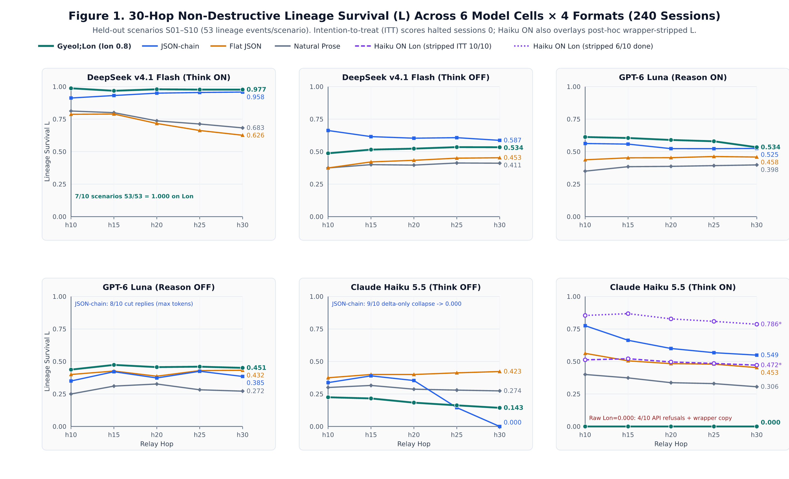
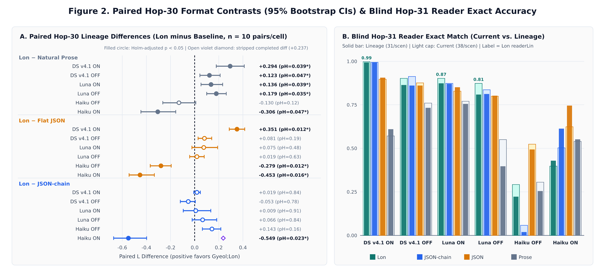

# Non-Destructive Epistemic Lineage, Key-Free Tamper Audit, and Calibrated Credibility Across 30-Hop LLM Relays with Gyeol;Lon[^1]

*Jaehoon Rieu* (Gyeol Project, Brisbane, Australia — `Human@gyeol.link`) · **With** Apart Research

**Abstract**

Multi-agent language model workflows frequently corrupt intermediate facts, paraphrase attributed quotes, and express uncalibrated confidence across extended handovers. We present **Gyeol** (**G**rammatically **Y**ielding **E**pistemically **O**riented **L**anguage—*Korean for "wood grain," and the texture or vibe of a thing*) and its verification profile **Gyeol;Lon** (**L**ineage **O**riented **N**otation), integrating append-only revision edges (`fix→`, `err→`), adaptive `<[[...]]>` verbatim evidence fences, oracle-free static auditing, and **Muk** (**M**easure **u**pon **K**nowledge) credibility calibration. In a pre-registered, SHA-256-locked 30-hop relay benchmark (240 sessions; 7,176 live calls) across DeepSeek v4.1 Flash, Claude Haiku 5.5, and GPT-6 Luna (reasoning enabled and disabled) over four symmetrical formats, `lon` with DeepSeek reasoning preserves 0.977 of lineage events (7/10 scenarios 100%) versus 0.683 for prose and 0.626 for flat JSON, achieving zero quote alterations (0/941) and 0.994 blind historical accuracy. Across all models without answer keys, static auditing attains 92.5% session defect recall and 94.1% hop precision at a 22.2-hop lead, avoiding prose's 100% clean-session false alarms. Held-out Muk weighting reduces ensemble Brier score by 20.4% (0.1145 to 0.0911), while `lon` cuts Hop-30 state size by 31% to 40% versus `JSON-chain` and enables prompt caching (38.9% to 40.0% on GPT-6 Luna). We also uncover Haiku 5.5 streaming refusal cascades across formats and wrapper-copy fragility, showing inspectable provenance adds defensive reliability even when agents fail.

---

## 1. Introduction

Long-horizon multi-agent deployments pass state through successive model handovers: triage notes, tool outputs, policy overrides, and derived metrics. Across dozens of sequential relays, three silent failure modes degrade collective epistemics even when single-turn reasoning looks strong. First, **destructive state overwrites** erase superseded or retracted values rather than preserving why a judgement changed, leaving downstream audits unable to reconstruct causal history. Second, **quote and delimiter corruption** mutates exact external strings during prose paraphrase or breaks rigid parsers when raw evidence contains quotation marks, backslashes, or closing delimiters. Third, **uncalibrated confidence** causes downstream readers and unweighted ensembles to trust persistently overconfident models or fail to detect silent relay decay without access to an oracle ground truth.

Rather than asking models to "remember carefully" inside free-form English or brittle ad-hoc JSON schemas, we investigate whether a lightweight epistemic notation can make provenance structure machine-checkable, tamper-evident, and credibility-weighted end to end. **Gyeol** (**G**rammatically **Y**ielding **E**pistemically **O**riented **L**anguage—*Korean for "wood grain," and the texture or vibe of a thing*) and its compact audit profile **Gyeol;Lon** (**L**ineage **O**riented **N**otation; wire header `lon 0.8`) represent claims as sequential numbered clauses carrying typed evidential markers (`see`, `rec`, `inf`, `gut`), pre-marker lineage edges (`fix→k`, `err→k`, `sup→k`), length-adaptive verbatim external-evidence fences (`<[...]>`, `<[[...]]>`), and per-clause **Muk** (**M**easure **u**pon **K**nowledge) confidence (`0–9`) paired with **Chae** (**C**ausal **H**ysteresis **a**t **E**mission, disclosed only in external specifications and never defined in participant prompts).

**Our main contributions are:**

1. **Non-Destructive Lineage & Adaptive Fences (`Gyeol;Lon v0.8 snapshot`):** We extend a zero-dependency parser and auditor with full-snapshot lineage continuity checks (`W40`, `W45`, `carryDiff`) and deeper `<[[...]]>` verbatim blocks that isolate arbitrary `]>` substrings across 30-hop relays.
2. **Pre-Registered 240-Session Relay Benchmark (`E13`) + Single-Turn Probes (`E5/E6b`):** Under SHA-256-frozen stimuli and exact paired permutation tests, we evaluate DeepSeek v4.1 Flash, Claude Haiku 5.5, and GPT-6 Luna (thinking/reasoning ON and OFF) across `lon`, `jsonchain`, `json`, and `natural` prose (`7,176` relay and blind `Reader` calls), quantifying both ceiling performance and derived-arithmetic reasoning bottlenecks (`0.977` `L` with DeepSeek ON).
3. **Oracle-Free Static Audit & Calibrated `Muk v6` / `Eq. E` Consensus:** Without answer keys, `lon` static verification detects defective 30-hop chains at `92.5%` session recall and `94.1%` hop precision (`22.2`-hop mean lead vs. `100%` clean-session false alarms in prose), while chronological train/test `Eq. E` weighting lowers multi-agent Brier error by `20.4%` and confirms empirical neutrality of the seven `Chae` color letters (`colorGain` near zero).
4. **Transparent Failure Decomposition & Cache Economics:** We isolate two genuine deployment hazards masked by aggregate averages—Anthropic streaming `finish: "refusal"` cascades (`49` ON / `40` OFF events across all formats) and prompt-wrapper boundary leaks (`=== End of document ===`, whose non-modifying strip restores Haiku ON completed `lon` survival to `0.786` and `V = 0.995`)—while measuring a `31%–40%` state size reduction versus `JSON-chain` and automatic GPT-6 Luna cache reuse (`38.9%–40.0%`).

## 2. Related Work

Formal provenance models such as W3C PROV-DM (Moreau & Missier, 2013) standardize entity-derivation-activity graphs for distributed databases, but assume deterministic emitters rather than stochastic LLM relays that drop, paraphrase, or truncate history. JSON schemas enforce syntactic containers, yet standard flat JSON encourages in-place mutation (`json` retains only `0.626` lineage survival even with reasoning ON in our data) while verbose AST chains (`jsonchain`) bloat token length and trigger output-limit truncation.

In epistemic calibration, proper scoring rules—most centrally the Brier score (Brier, 1950; Gneiting & Raftery, 2007)—guarantee that truth-telling confidence maximizes expected score. Empirical studies show modern neural networks and RLHF-tuned LLMs suffer systematic overconfidence and miscalibration (Guo et al., 2017; Kadavath et al., 2022; Lin et al., 2022), particularly under deceptive or adversarial context. **Muk v6** adapts improper-overconfidence suppression via small-sample unbiased calibration-gap estimation and bounded log-odds discounting (`Eq. E`), decoupling epistemic reliability from raw accuracy and preserving strict indifference across ungrounded auxiliary tokens (`Chae` non-definition). Finally, Constitutional AI and safety classifiers (Bai et al., 2022) reduce harmful generation but can trigger false-positive stream refusals when dense structured notation resembles security logs—a failure mode our multi-format pre-registered design directly surfaces.

## 3. Methods

### 3.1 Gyeol;Lon (`lon 0.8 · snapshot`) Grammar and Non-Destructive Rules

Each `lon` handover note begins with `lon 0.8 · snapshot · lang en` followed by sequential clauses starting from `1` without gaps:

```text
lon: <N · [markers] concise label *C8↓grounds> evdM <[verbatim text]>
```

where `N` is a strictly increasing integer, `[markers]` encodes evidential status (`see`, `rec`, `inf`, `gut`), limits/tense (`lim`, `pst`, `fut`), and speech act (`say`, `ask`, `req`, `let`, `vow`, `nay`, `ack`). Relation prefixes (`fix→k` revision, `err→k` retraction, `sup→k` later ground) appear between `·` and `[`. In `snapshot` mode, agents must preserve clauses `1..k` verbatim before appending updates; edits to historical numbers or claims violate non-destruction. External strings containing `]>` (including line-range notations such as `<[L1]>`) must be wrapped in `<[[...]]>`, preventing premature fence termination. Every clause ends with `*<chae><0–9>`, where `<chae>` is one of `R G B C M Y K`. Critically, obeying the **Chae color non-definition axiom**, no semantic meaning, rubric, or cue is ever attached to these seven letters in any prompt or documentation.

### 3.2 Symmetrical Four-Format Design & Pre-Registered E13 Protocol

To avoid confounding formatting benefits with asymmetric task instructions, all four formats share the exact same semantic `POLICY` requiring full snapshot carry-forward, byte-exact value retention, document attribution (`evdN`), non-destructive revisions/withdrawals, and computed metric dependency links:

- `natural`: Numbered plain-English lines `[1], [2], ...` with quoted values, `revises [k]`, `withdraws [k]`, and `from [a], [b]`.
- `json`: Single JSON object `{"items": [{"id", "item", "value", "source", "revises", "retracts"}]}`.
- `jsonchain`: Stepwise graph `{"steps": [{"n", "claim", "evidence", "revises", "retracts", "grounds", "quotes"}]}`.
- `lon`: `Gyeol;Lon v0.8 snapshot` clauses with external `<[...]> / <[[...]]>` relay blocks.

Our pre-registration (`prereg-e13.md`, hashes in `prereg-e13.sha256` frozen before live runs) fixes `10` held-out scenarios (`S01..S10`, deterministic PRNG seed `20261117`). Each scenario spans `30` handover documents (`evd*`) plus `1` blind `Reader` call at Hop 31 (`31` steps/session): `53` lineage events (`20` amend, `29` recompute across derived quantities `D1..D4`, `4` withdraw), `34` final in-force payloads (`58` total historical payloads) spanning `plain`, `JSON-hazard` (quotes, backslashes, multi-line strings), and `Lon-hazard` (`]>` substrings), and `69` blind `Reader` queries (`38` current-state, `31` lineage/historical). We evaluate `6` model cells (`240` sessions; `7,440` planned calls, `7,176` recorded rows including transient retries): `DeepSeek v4.1 Flash` (`deepseek_on`/`off`), `Claude Haiku 5.5` (`haiku_on`/`off`), and `GPT-6 Luna` (`luna_on`/`off`). Pilots `E1–E12` and scenario `L01` used distinct stimuli solely for parser debugging before freezing `S01..S10`.

### 3.3 Endpoints, Statistical Plan, Key-Free Audit, and Muk v6 / Eq. E

We pre-register five families of endpoints:

1. **Potential 1 (`L`, `L_strict`, `V`, `Vh`, `Reader`):** Primary `L` averages survival across all `53` Hop-30 lineage events, requiring (a) verbatim survival of the new payload, (b) non-destructive verbatim preservation of the prior payload, and (c) an explicit revision/withdrawal/computed edge evaluated symmetrically via `readNoteJoined` (`allowReach: true`; `L_strict` uses `false`). Paired `lon − baseline` scenario differences (`n = 10`) are tested with exact two-sided sign-flip permutations (`2^10 = 1,024` states), 2,000-draw paired bootstrap 95% CIs, and Holm step-down adjustment across the `6` cells. Under intention-to-treat (ITT), three consecutive empty API replies halt a session with score `0` from that hop onward.
2. **Potential 2 (Tamper-Evidence):** Stratified verbatim survival across `plain`, `JSON-hazard`, and `Lon-hazard` subsets plus rate of altered/forged attributed quotes across final notes.
3. **Potential 3 (Oracle-Free Static Audit):** Executed per hop (`1,800` hops/format) using only `(docs[0..h-1], note_{h-1}, note_h)` and ZERO answer keys: `lon` checks `parseTurn v0.8` diagnostics (`W40`, `W44`, `W45`, `E01..E46`), verbatim `evdM <[...]> / <[[...]]>` substrings, and `carryDiff` prior-clause integrity; baselines check schema/numbering parse validity, verbatim quotes, and prior-entry carry-forward. We score hop recall/precision, onset recall, session recall/precision, clean-session false alarm rate, and mean lead time before Hop 30.
4. **Potential 4 (`Muk v6` & `Eq. E`):** Emitted `lon` clauses with confidence `c ∈ {0..9}` (`p = (c + 0.5)/10`) yield credibility base `credBase` (prior midpoint `5`, gap slope `25`, tolerance `0.05`, evidence weight `6`; full equations in Appendix C) and rounded grade `0..9`. To test `Eq. E` (`w_m = 1 - counterShare(grade_m, conf, 5, 'E')`), per-model grades are learned strictly on scenarios `S01..S05` and applied out-of-sample to `345` consensus queries on held-out `S06..S10`. Cross-split `colorGain` verifies that `Chae` colors `R G B C M Y K` add zero Brier improvement. We synthesize with pre-registered single-turn probes (`E5/E6b`, `n = 98`, `prereg-e5-e6.sha256`).
5. **Potential 5 (Efficiency):** Hop-30 character length, prefix-cache hit percentage (`cached / tin`), latency, `USD/settled session`, and `L / (USD/session)`.

## 4. Results

### 4.1 Non-Destructive Lineage Survival and Blind Reader Accuracy (Potential 1)

All `240/240` sessions settled (`$18.31` total API spend). **Table 1** and **Figure 1** summarize Hop-30 survival and Hop-31 blind `Reader` accuracy.



With reasoning enabled on DeepSeek v4.1 Flash (`deepseek_on`), `Gyeol;Lon` achieves `L = 0.977` (`L_strict = 0.977`, `V = 1.000`, `Vh = 1.000`, `7/10` scenarios `53/53 = 1.000`) and near-perfect blind `Reader` comprehension (`0.997` current, `0.994` historical lineage). On paired comparisons (**Figure 2**), `deepseek_on | lon` outperforms `natural` prose by `+0.294` (`[0.179, 0.411]`, `p_Holm = 0.0391`; Reader lineage `+0.384`, `p_Holm = 0.0234`) and flat `json` by `+0.351` (`[0.287, 0.415]`, `p_Holm = 0.0117`; Reader lineage `+0.087`, `p_Holm = 0.0117`), while remaining compactly ahead of `jsonchain` (`+0.019`, `p_Holm = 0.844`) with 34.4% fewer characters.

Across GPT-6 Luna (`luna_on` / `luna_off`) and non-reasoning DeepSeek (`deepseek_off`), `lon` consistently outperforms `natural` prose (`+0.136`, `p_Holm = 0.0391`; `+0.179`, `p_Holm = 0.0352`; `+0.123`, `p_Holm = 0.0469`), driven by `0.953–1.000` verbatim preservation and clean `amend_*` / `withdraw_*` retention (`0.900–1.000`). Category decomposition reveals why `L` plateaus around `0.451–0.534` without sufficient reasoning: across `deepseek_off`, `luna_off`, and `luna_on`, `amend_*` and `withdraw_*` succeed (`0.90–1.00`), whereas multi-hop arithmetic recomputation (`recompute_D1..D4`, 29/53 events) drops to `0.014–0.300`. In `haiku_off`, `jsonchain` suffers 9/10 delta-only collapses (`L = 0.000`, `V = 0.094`), giving `lon` (`0.143`, `V = 0.588`) a `+0.494` raw `V` advantage (`p = 0.0156`).



| Cell | Fmt | Brk | L | V | R-Lin | Chars | Cache | USD | Obs / Note |
| :--- | :--- | ---: | ---: | ---: | ---: | ---: | ---: | ---: | :--- |
| `deepseek_on` | `lon` | 0 | **0.977** | **1.000** | **0.994** | **19,001** | **87.3%** | $2.211 | 7/10 = 1.000 |
| `deepseek_on` | `jsonchain` | 0 | 0.958 | 1.000 | 0.994 | 28,959 | 83.3% | $2.501 | +52% longer |
| `deepseek_on` | `json` | 0 | 0.626 | 0.994 | 0.906 | 9,895 | 80.9% | $1.468 | overwrites old |
| `deepseek_on` | `natural` | 0 | 0.683 | 0.988 | 0.610 | 6,326 | 80.0% | $1.680 | cut=7 |
| `deepseek_off` | `lon` | 0 | 0.534 | **1.000** | **0.865** | 11,971 | 79.7% | $0.853 | V=1.000 |
| `deepseek_off` | `jsonchain` | 0 | 0.587 | 0.997 | 0.861 | 17,395 | 84.1% | $1.239 | +45% cost |
| `luna_on` | `lon` | 0 | **0.534** | **0.953** | **0.874** | **17,408** | **38.9%** | $0.600 | only cached |
| `luna_on` | `jsonchain` | 0 | 0.525 | 0.926 | 0.871 | 24,670 | 0.0% | $0.745 | 0% cache |
| `luna_off` | `lon` | 0 | **0.451** | **0.974** | 0.810 | **16,177** | **40.0%** | $0.454 | cut=0 |
| `luna_off` | `jsonchain` | 0 | 0.385 | 0.841 | 0.813 | 27,065 | 0.0% | $0.797 | cut=8/10 |
| `haiku_off` | `lon` | 2 | 0.143 | 0.588 | 0.223 | 9,486 | 51.3% | $0.416 | refusals=19 |
| `haiku_off` | `jsonchain` | 2 | 0.000 | 0.094 | 0.019 | 2,592 | 22.6% | $0.446 | deltaOnly=9 |
| `haiku_on` | `lon` | 4 | 0.000 | 0.021 | 0.429 | 14,145 | 44.3% | $0.516 | strip=0.786\* |
| `haiku_on` | `jsonchain` | 1 | 0.549 | 0.718 | 0.613 | 18,714 | 14.8% | $0.880 | refusals=12 |

*Table 1.* Key E13 cells (`10` scenarios/cell; full 24-cell metrics in Appendix B). `Brk` = broken sessions (ITT 3 empty replies); `R-Lin` = Hop-31 Reader lineage accuracy. \*Post-hoc wrapper stripping restores `6/10` completed `haiku_on lon` sessions to `L = 0.786`, `V = 0.995`.

### 4.2 Verbatim Tamper-Evidence & Key-Free Static Audit (Potentials 2 & 3)


**Verbatim Hazard Survival & Quote Integrity:** Across non-refusing models, adaptive `<[[...]]>` blocks neutralize `]>` injection cleanly: `deepseek_on | lon` and `deepseek_off | lon` retain `1.000` across `plain`, `JSON-hazard`, and `Lon-hazard` payloads, while `luna_off | lon` achieves `0.975` on `Lon-hazard` (vs. `0.587`/`0.675` JSON/Lon hazard on `luna_off | natural`). Most sharply, final-note attributed quote/relay alteration is `0/941 (0.0%)` on `deepseek_on | lon`, `5/491 (1.0%)` on `luna_off | lon`, and `6/498 (1.2%)` on `luna_on | lon`, whereas `natural` prose alters `7.9%` (`ds_on`), `18.8%` (`ds_off`), `39.5%` (`luna_on`), and `56.3%` (`luna_off`, `1,126/2,000` spans) of attributed spans.

**Key-Free Static Audit (`1,800` hops/format):** Without any oracle key (**Table 2**, **Figure 3A**), `lon` detects `92.5%` of defective sessions (`sPrecision = 0.961`, `hop recall = 0.762`, `hop prec = 0.941`, `onset recall = 0.824`) at an average warning lead of `22.2` hops before Hop 30. Prose flags `100%` of clean sessions (`clean FA = 1.000`) due to unquoted paraphrase drift, rendering prose alarms unusable. Conversely, `json` (`0.456`) and `jsonchain` (`0.391`) miss over half of defective hops because syntactically valid JSON masks broken lineage semantics. Cell-level decomposition shows `lon` achieves `0.000` clean-session false alarms on 5/6 cells (`1.000` session recall on `ds_off`, `haiku_off`, `haiku_on`, `luna_off`; `0.900` on `luna_on`), whereas the sole clean false alarms (`2/7 = 0.286` overall) occur in `ds_on` (`S06` minor `E19/E33/W40` lint; `S09` single hop-28 `CARRY_ALTER`) while `ds_on`'s only `3/10` missed events were silent arithmetic recomputation omissions inside syntactically compliant `inf` clauses.

| Format | Hops | TP | FP | Hop Rec | Hop Prec | Onset Rec | Sess Rec | Sess Prec | Clean FA | Lead (h) |
| :--- | ---: | ---: | ---: | ---: | ---: | ---: | ---: | ---: | ---: | ---: |
| `lon` | 1800 | 980 | 61 | **0.762** | 0.941 | **0.824** | **0.925** | 0.961 | 0.286 | **22.2** |
| `json` | 1800 | 711 | 0 | 0.456 | 1.000 | 0.451 | 0.583 | 1.000 | 0.000 | 22.1 |
| `jsonchain` | 1800 | 536 | 1 | 0.391 | 0.998 | 0.428 | 0.691 | 1.000 | 0.000 | 16.8 |
| `natural` | 1800 | 1639 | 2 | 0.973 | 0.999 | 0.963 | 1.000 | 0.967 | **1.000** | 26.6 |

*Table 2.* Key-free static audit over `1,800` hops (`60` sessions) per format using zero ground-truth labels.

### 4.3 Muk v6 Epistemic Credibility, Chae Neutrality & Eq. E Consensus (Potential 4)

Across `lon` runs (**Figure 4A**, **Appendix B.3**), `Muk v6` accurately ranks epistemic reliability: `luna_on` earns `Grade 9` (`credBase 8.70, gap 0.0000, Brier 0.0795`), `ds_on`, `ds_off`, and `luna_off` earn `Grade 7` (`Brier 0.0480–0.0697`), while failure-affected `haiku_off` and raw `haiku_on` drop to `Grade 4` and `Grade 0` (post-hoc stripped `haiku_on`: `Grade 5, credBase 5.49, Brier 0.0551`). Crucially, out-of-sample `colorGain` across `S01..S05` vs. `S06..S10` spans `[-0.0167, +0.0001]`, empirically confirming that `R G B C M Y K` encode zero hidden signal under the `Chae` non-definition axiom.

Testing `Eq. E` inverse-counter weights on held-out `S06..S10` (`345` queries) using grades learned strictly on `S01..S05` (`ds_on 8, luna_on 8, luna_off 8, ds_off 7, haiku_off 2, haiku_on 1`) cuts ensemble Brier loss by **20.4%** (`0.1145` unweighted vs. `0.0911` `Muk Eq. E`) at matching accuracy (`0.899` vs. `0.896`). Single-turn adversarial probes (`E5/E6b`, `n = 98`) reinforce this mechanism: when models fall for forged chains, `lon` exposes both planted premises inside parsed grounds `84%–90%` of the time (`84%` Haiku/GLM, `90%` Luna) versus `8%–46%` (`natural`) and `0%–36%` (`json`), lifts blind reviewer AUROC (`0.65` vs. `0.53` prose, `+0.12 [0.02, 0.23]`, and `0.43` `json`, `+0.22 [0.11, 0.33]`), and allows the two-fold `Muk` gate (`grade >= 5`) to block `100% (0/98)` of overconfident `Grade-1` planted adoptions where confidence `>= 7` gating lets `63–64` pass.


### 4.4 Long-Horizon Efficiency & Prefix Caching (Potential 5)

As relay depth reaches Hop 30 (**Figure 5**), `lon` stays `31%–40%` more compact than `jsonchain` (`19,001` vs. `28,959` chars on `deepseek_on`; `16,177` vs. `27,065` on `luna_off`, where `jsonchain` hit max-output limits in `8/10` sessions while `lon` had `0` truncations). Because `lon`'s rule sheet + immutable prefix structure align with provider prefix-cache boundaries, `lon` triggers `87.3%` cache hits on `ds_on` (`$0.221` vs. `$0.250` per session on `jsonchain`) and is the *only* format triggering explicit OpenAI prefix caching on `GPT-6 Luna` (`38.9%` ON, `40.0%` OFF vs. `0.0%–0.8%` across baselines), cutting settled session cost by `19.4%` (`$0.060` vs. `$0.075`) and `43.1%` (`$0.045` vs. `$0.080`).


### 4.5 Post-Hoc Error Decomposition: Haiku Safety Refusals & DeepSeek Ceiling

Programmatic telemetry inspection across all `7,176` rows (**Appendix B**) isolates two clean root causes for remaining imperfections without altering pre-registered outcomes:

- **Claude Haiku 5.5 Streaming `finish: "refusal"` Cascades:** Neither DeepSeek (`0`) nor Luna (`0`) triggered API refusals, whereas Anthropic's classifier terminated `haiku_on` (`49` refusals: `29` empty, `20` mid-stream across all 4 formats: `natural 12`, `json 7`, `jsonchain 12`, `lon 18`) and `haiku_off` (`40` refusals: `15` empty, `25` mid-stream: `natural 9`, `json 1`, `jsonchain 11`, `lon 19`). Empty refusals halted `4/10` `haiku_on | lon` sessions at Hop 3 (`S02, S03, S04`) and Hop 4 (`S10`).
- **Prompt-Wrapper Boundary Leak (`haiku_on | lon`):** Across all `6/10` completed sessions (`S01, S05..S09`), `haiku_on` copied `=== End of document evdN ===` inside `<[...]>`, failing strict verbatim inclusion (`0.000` raw `L`). Non-modifying regex removal of wrapper banners alone restores completed sessions (`6/10`) to `V = 0.995`, `Vh = 0.989`, `L = 0.786` (`S01 = 53/53 = 1.000`), and `7/377` (`0.019`) altered spans (`ITT 10/10`: `L = 0.472`, `Muk Grade 5`, `Brier = 0.0551`).
- **`deepseek_on | lon` Residual Failures:** All `12/530` missed events (`2.3%`) across `3/10` scenarios stemmed exclusively from semantic arithmetic recomputation omissions (`S02` `D2_v8`; `S03` `D2_v4`; `S05` 10 cascading versions from `D2_v3`), with `0` dropped quotes (`0/941`).

## 5. Discussion and Limitations

The E13 and E5/E6b findings highlight a clear architectural split between *parametric capability* and *protocol-level inspectability*. Reasoning compute determines whether an agent accurately recomputes multi-hop derived state (`0.977` `L` on `ds_on` vs. `0.451–0.534` on non-reasoning cells), yet epistemic notation governs whether *external auditors and downstream readers* can trust what happened. Under natural prose, humans or agents cannot verify claims without an answer key (`100%` clean-session false alarms; `up to 56.3%` mutated quotes). Under `Gyeol;Lon`, append-only clauses and `<[[...]]>` verbatim fences decouple auditability from upstream capability: bad hops are detected `22.2` hops early without keys, and poorly calibrated agents are suppressed out-of-sample via `Muk v6` / `Eq. E`.

### Limitations

First, `n = 10` scenarios per cell yields adequate power for large format effects (`> 0.13` `L`) after Holm correction, but smaller margins require larger test suites. Second, scenarios test structured operational handovers rather than open-ended code synthesis or multimodal tool use. Third, key-free static audit verifies structural integrity, carry-forward, and verbatim evidence rather than executing domain arithmetic inside valid `inf` clauses (missing `ds_on` `D1/D2` arithmetic drift in `S02/S03/S05`). Fourth, provider safety classifiers and outer prompt wrappers (`=== End of document ===`) interact asymmetrically with dense wire syntax.

### Future Work

Immediate next steps include wrapping `parseTurn` and `carryDiff` inside an automated single-turn self-repair loop triggered whenever static audit fires (`22.2`-hop early interception), pairing `Gyeol;Lon` with deterministic sandbox execution for `inf` derived formulas, hardening document framing tokens against accidental boundary copying, and releasing `Gyeol;Pan` interactive audit traces for asynchronous tool-calling swarms.

## 6. Conclusion

Across 240 pre-registered 30-hop handover sessions and complementary single-turn forged-premise probes, **Gyeol;Lon (`lon 0.8 · snapshot`)** establishes that a minimal epistemic notation simultaneously strengthens lineage survival (`0.977` on reasoning DeepSeek; significant gains over prose across all four non-refusal cells), eliminates attributed quote alteration (`0.0%` on `ds_on`), enables `92.5%` oracle-free defect detection at `22.2`-hop lead, cuts multi-agent Brier error by `20.4%` via held-out `Muk v6` / `Eq. E` weighting, and shrinks long-horizon state footprint by `31%–40%` while unlocking explicit prompt caching. Even where frontier models trigger refusal cascades or arithmetic slips, structured non-destructive provenance preserves inspectable evidence for safe multi-agent governance.

---

## Code and Data

All zero-dependency TypeScript/Node.js source code, pre-registered SHA-256 manifests (`prereg-e13.sha256`, `prereg-e5-e6.sha256`), synthetic held-out stimuli (`data/sessions-e13.json`), scoring harness (`src/score-e13.mjs --selftest`), post-hoc decomposition (`src/diag-e13-posthoc.mjs`), and figure generators are staged for public verification:

- **Code & Benchmark Repository:** https://github.com/jaerieu/Gyeol_Public/tree/main/benchmarks/apart-epistemics-2026
- **Project Observatory (`Gyeol;Pan`):** https://gyeol.link
- **Self-Verification Commands:** `sha256sum -c prereg-e13.sha256` (`7/7` verified) and `node src/score-e13.mjs --selftest --sessions data/sessions-e13.json` (zero external dependencies).

## Author Contributions

Jaehoon Rieu conceived the **Gyeol** language, **Gyeol;Lon** snapshot grammar, **Muk v6** epistemic scoring design, and **Chae** non-definition axiom; designed the E1–E13 experimental progression and pre-registration locks; supervised automated execution, post-hoc verification, and failure-mode auditing; and reviewed and approved the final manuscript and public artifacts.

## References

1. Bai, Y., Kadavath, S., Kundu, S., Askell, A., Kernion, J., Jones, A., Chen, A., Goldie, A., Mirhoseini, A., McKinnon, C., et al. (2022). Constitutional AI: Harmlessness from AI Feedback. *arXiv preprint arXiv:2212.08073*.
2. Brier, G. W. (1950). Verification of forecasts expressed in terms of probability. *Monthly Weather Review*, 78(1), 1–3.
3. Gneiting, T., & Raftery, A. E. (2007). Strictly proper scoring rules, prediction, and estimation. *Journal of the American Statistical Association*, 102(477), 359–378.
4. Guo, C., Pleiss, G., Sun, Y., & Weinberger, K. Q. (2017). On calibration of modern neural networks. *Proceedings of the 34th International Conference on Machine Learning (ICML)*, PMLR 70:1321–1330.
5. Holm, S. (1979). A simple sequentially rejective multiple test procedure. *Scandinavian Journal of Statistics*, 6(2), 65–70.
6. Kadavath, S., Conerly, T., Askell, A., Henighan, T., Drain, D., Perez, E., Schiefer, N., Hatfield-Dodds, Z., DasSarma, N., Tran-Johnson, E., et al. (2022). Language Models (Mostly) Know What They Know. *arXiv preprint arXiv:2207.05221*.
7. Lin, S., Hilton, J., & Evans, O. (2022). Teaching Models to Express Their Uncertainty in Words. *Transactions on Machine Learning Research (TMLR)*.
8. Moreau, L., & Missier, P. (Eds.) (2013). *PROV-DM: The PROV Data Model*. W3C Recommendation, 30 April 2013. https://www.w3.org/TR/prov-dm/.

## Appendix A: Limitations and Dual-Use

### A.1 Methodological Assumptions and Validity Boundaries

- **Construct vs. Semantic Execution Gap:** Key-free static auditing verifies syntax (`E01–E46`), lineage carry-forward (`carryDiff`), source presence (`W40`), snapshot numbering monotonicity (`W45`), and exact byte matching of external `<[...]>`/`<[[...]]>` relays (`92.5%` session recall at `0.000` clean FA on 5/6 cells). However, it assumes that if an `inf` derived clause preserves its dependency pointers (`↓a↓b`), its numerical arithmetic is checked separately. As seen in `deepseek_on | lon` (`S02, S03, S05`), arithmetic recomputation errors inside syntactically valid `inf` clauses evade pure structural checks without an arithmetic verifier.
- **Scenario Sample Size and External Validity:** While 7,176 calls across 240 sessions provide substantial hop-level resolution (`1,800` hops/format), paired scenario inference rests on `n = 10` held-out scenarios per model cell. Effects exceeding `0.12` in `L` easily clear Holm correction across 6 cells, whereas subtler differences between `lon` and `jsonchain` on well-behaved reasoning models (`+0.019`) remain indistinguishable from parity in `L` while separating cleanly on state compactness (`-34.4%` chars) and cache activation.
- **Safety Classifier Interactions (`Claude Haiku 5.5`):** Our pre-registration locked retry logic without prompt modification or content filtering. Anthropic's streaming classifier emitted `finish: "refusal"` across all formats (`49` ON, `40` OFF), disproportionately halting `haiku_on lon` early when dense symbolic brackets coincided with operational handover terminology. Prompt designers deploying structured provenance formats must test safety-classifier false positives in addition to syntactic compliance.
- **Wrapper Boundary Bleed:** Using `=== End of document evdN ===` as the prompt framing boundary while asking weaker/adaptive-thinking models (`haiku_on`) for strict verbatim relay caused the model to include the outer banner inside `<[...]>`. Distinct out-of-band XML/JSON tool boundaries should be preferred over ASCII banners in production relays.

### A.2 Dual-Use Considerations and Misuse Mitigations

- **False Assurance from Syntactically Valid Collusion ("Clean Wash"):** A risk specific to epistemic infrastructure is over-trusting syntactically valid, properly cited `Gyeol;Lon` transcripts when upstream agents collude to fabricate primary observations or perform wrong arithmetic inside `inf` clauses. *Mitigation:* We explicitly preserve `L` (semantic ground-truth scoring), require human or executable verification of `inf` derivations in high-stakes pipelines, and keep `Muk v6` trust bounded (`MUK.high = 7`, inverse weighting `Eq. E`) rather than treating high syntax compliance alone as proof of semantic truth.
- **Safety Filter Evasion Risk:** Because dense semi-structured formats trigger varied classifier sensitivity, malicious actors might test structured wrappers to probe moderation boundaries. *Mitigation:* All `Gyeol;Lon` external blocks `<[[...]]>` are plaintext inspectable without obfuscation or encoding, keeping content transparent to standard moderation filters while preventing accidental parser injection (`]>`).
- **Goodharting Confidence Digits and `Chae` Slots:** Agents fine-tuned solely to optimize perceived `Muk` grade could game confidence heuristics. *Mitigation:* Proper Brier calibration inside `Muk v6` makes honest probability reporting strictly optimal, short half-life forgetting (`60` answers) erases stale high ratings quickly after overconfident misses, and our strict `Chae` non-definition axiom prohibits assigning hidden grading shortcuts to `R G B C M Y K`.

## Appendix B: Pre-Registration SHA-256 Registry, Pilot History, and Full 24-Cell Tables

### B.1 Frozen File Digests (`prereg-e13.sha256`, Verified 7/7 OK)

| Frozen Pre-Registered Path | SHA-256 Digest |
| :--- | :--- |
| `data/sessions-e13.json` | `24daa1a720a0e070a0d095ef52d0bf903a8ed47b2e2a75e4e562b1188e0f12ec` |
| `prompts/lon-base-10fba3d-en.txt` | `a9fe84da837d7fdeb69f0f057cd09af17eda34a7411e119a5d02da5e744f8d79` |
| `src/prompts-e13.mjs` | `07fb61ea421ecef1d8df2cdc8d06f68c4c31e01e994839045217c2dfb21c6b0a` |
| `src/run-e13.mjs` | `08dd98b59cd96db5302eacbd99f724e9c77c4a3fdbab83e5f5157cf752383e5d` |
| `src/score-e13.mjs` | `cd50d00ecf8c59e910eacc887cae3b2f47316e9dd3ac37edfe9eb84adc9be291` |
| `overnight-e13.sh` | `730c9709cf264a756c68abdebb4bef2385855be933044322305d07567decb40f` |
| `vendor/gyeol-10fba3d/src/index.ts` | `8990de86855ed70350540654c0b7fd9dc6b230037d1b290a82653e75a4787c5e` |

*Verification:* All 7 SHA-256 digests verified identically via `sha256sum -c prereg-e13.sha256` against frozen `gyeol` commit `10fba3d` (`e13-snapshot` branch, `928/928` unit tests passing).

### B.2 Chronological Pilot Disclosure (`E1–E12` & `L01` Re-Pilot)

Prior to freezing `E13`: (1) `E1–E4` (`hard40` 24 items, `main40` 72 items) established forged-chain failure and `Muk v6` separation (`haiku` grade `3–6` vs. `luna` grade `1`); (2) `E5/E6b` (`100` items × `16` cells + `1,600` blind reviews, `98`-item sensitivity in `report/metrics-e5-sens.md`) quantified premise exposure (`P1b`), key-free lift (`P2`), tamper evidence (`P3`), reviewer AUROC (`P4`), and `S1` Muk gate; (3) `E7–E10` tested 8-hop chains (`20` scenarios × `6` cells), showing 8 hops were too short for full degradation; (4) `E11–E12` (`sessions-e12.json`) and calibration scenario `L01` surfaced 4 bugs fixed in commit `10fba3d` (`snapshot` mode + `W40/W45/carryDiff`, `<[[...]]>` fence rules, pre-`[` relation prefix order, and Anthropic `thinking: {type: 'disabled'}` cleanly recovering `deepseek_off lon` from `0.000` to `L = 0.887, V = 0.912` on `L01` before locking `S01..S10`). No `S01..S10` scenario ran before the pre-registration lock.

### B.3 Complete 24-Cell E13 Metrics (Potentials 1, 2, 4, and 5)

| Model | Fmt | Brk | L | L str | V | Vh | R Cur | R Lin | h30 Chars | Cache | Altered | USD |
| :--- | :--- | ---: | ---: | ---: | ---: | ---: | ---: | ---: | ---: | ---: | ---: | ---: |
| `deepseek_off` | `json` | 0 | 0.453 | 0.443 | 0.991 | 0.995 | 0.876 | 0.861 | 8696 | 82.0% | 0.036 | 0.6822 |
| `deepseek_off` | `jsonchain` | 0 | 0.587 | 0.532 | 0.997 | 0.998 | 0.913 | 0.861 | 17395 | 84.1% | 0.000 | 1.2392 |
| `deepseek_off` | `lon` | 0 | 0.534 | 0.511 | 1.000 | 1.000 | 0.903 | 0.865 | 11971 | 79.7% | 0.046 | 0.8533 |
| `deepseek_off` | `natural` | 0 | 0.411 | 0.374 | 0.897 | 0.928 | 0.761 | 0.732 | 3771 | 77.4% | 0.188 | 0.3125 |
| `deepseek_on` | `json` | 0 | 0.626 | 0.626 | 0.994 | 0.995 | 0.897 | 0.906 | 9895 | 80.9% | 0.011 | 1.4677 |
| `deepseek_on` | `jsonchain` | 0 | 0.958 | 0.936 | 1.000 | 1.000 | 0.995 | 0.994 | 28959 | 83.3% | 0.000 | 2.5007 |
| `deepseek_on` | `lon` | 0 | **0.977** | **0.977** | **1.000** | **1.000** | **0.997** | **0.994** | 19001 | 87.3% | **0.000** | 2.2108 |
| `deepseek_on` | `natural` | 0 | 0.683 | 0.683 | 0.988 | 0.990 | 0.571 | 0.610 | 6326 | 80.0% | 0.079 | 1.6795 |
| `haiku_off` | `json` | 0 | 0.423 | 0.417 | 0.821 | 0.881 | 0.524 | 0.494 | 8807 | 23.8% | 0.016 | 0.4116 |
| `haiku_off` | `jsonchain` | 2 | 0.000 | 0.000 | 0.094 | 0.055 | 0.058 | 0.019 | 2592 | 22.6% | 0.000 | 0.4457 |
| `haiku_off` | `lon` | 2 | 0.143 | 0.136 | 0.588 | 0.586 | 0.292 | 0.223 | 9486 | 51.3% | 0.099 | 0.4157 |
| `haiku_off` | `natural` | 1 | 0.274 | 0.262 | 0.691 | 0.736 | 0.305 | 0.255 | 4495 | 34.7% | 0.192 | 0.2079 |
| `haiku_on` | `json` | 1 | 0.453 | 0.453 | 0.732 | 0.786 | 0.624 | 0.745 | 11946 | 19.7% | 0.063 | 0.5803 |
| `haiku_on` | `jsonchain` | 1 | 0.549 | 0.549 | 0.718 | 0.772 | 0.503 | 0.613 | 18714 | 14.8% | 0.041 | 0.8797 |
| `haiku_on` | `lon` | 4 | 0.000 | 0.000 | 0.021 | 0.050 | 0.397 | 0.429 | 14145 | 44.3% | 0.451 | 0.5163 |
| `haiku_on` | `natural` | 1 | 0.306 | 0.306 | 0.662 | 0.731 | 0.539 | 0.552 | 4522 | 33.9% | 0.045 | 0.3033 |
| `luna_off` | `json` | 0 | 0.432 | 0.404 | 0.888 | 0.919 | 0.800 | 0.803 | 7319 | 0.8% | 0.024 | 0.2836 |
| `luna_off` | `jsonchain` | 0 | 0.385 | 0.336 | 0.841 | 0.852 | 0.837 | 0.813 | 27065 | 0.0% | 0.013 | 0.7973 |
| `luna_off` | `lon` | 0 | 0.451 | 0.392 | 0.974 | 0.978 | 0.874 | 0.810 | 16177 | 40.0% | 0.010 | 0.4537 |
| `luna_off` | `natural` | 0 | 0.272 | 0.245 | 0.738 | 0.772 | 0.550 | 0.397 | 3081 | 0.0% | 0.563 | 0.1756 |
| `luna_on` | `json` | 0 | 0.458 | 0.442 | 0.900 | 0.928 | 0.829 | 0.852 | 9399 | 0.0% | 0.009 | 0.3364 |
| `luna_on` | `jsonchain` | 0 | 0.525 | 0.458 | 0.926 | 0.950 | 0.874 | 0.871 | 24670 | 0.0% | 0.012 | 0.7451 |
| `luna_on` | `lon` | 0 | 0.534 | 0.492 | 0.953 | 0.962 | 0.903 | 0.874 | 17408 | 38.9% | 0.012 | 0.6004 |
| `luna_on` | `natural` | 0 | 0.398 | 0.379 | 0.879 | 0.898 | 0.771 | 0.755 | 5381 | 0.0% | 0.395 | 0.2129 |

| Muk v6 Cell (`lon`) | Clauses | Chae | Acc | CredBase | Grade | Cal Gap | Brier | Overconf | colorGain |
| :--- | ---: | ---: | ---: | ---: | ---: | ---: | ---: | ---: | ---: |
| `deepseek_off` | 712 | 673 | 0.968 | 6.840 | 7 | 0.0811 | 0.0480 | 0.034 | +0.0001 |
| `deepseek_on` | 1475 | 1472 | 0.945 | 7.217 | 7 | 0.0644 | 0.0697 | 0.055 | 0.0000 |
| `haiku_off` | 517 | 505 | 0.758 | 4.455 | 4 | 0.1833 | 0.1732 | 0.238 | -0.0167 |
| `haiku_on` (raw) | 529 | 529 | 0.382 | 0.335 | 0 | 0.3751 | 0.4307 | 0.609 | +0.0001 |
| `haiku_on` (strip) | 529 | 529 | 0.977 | 5.491 | 5 | 0.1389 | 0.0551 | n/a | n/a |
| `luna_off` | 848 | 838 | 0.942 | 7.318 | 7 | 0.0605 | 0.0640 | 0.058 | 0.0000 |
| `luna_on` | 1360 | 1351 | 0.920 | 8.696 | 9 | 0.0000 | 0.0795 | 0.080 | -0.0017 |

## Appendix C: Gyeol;Lon v0.8 Grammar Card & Muk v6 / Eq. E Equations

- **Wire Syntax:** `lon 0.8 · snapshot · lang en` header; sequential clauses `lon: <N · [markers] label *C8↓grounds>` (with relation prefixes `fix→k`, `err→k`, `sup→k` placed strictly between `·` and `[`); external blocks `evdM <[ ... ]>` or `evdM <[[ ... ]]>` when payload contains `]>`.
- **Chae Non-Definition Axiom:** Allowed letters `C ∈ {R, G, B, C, M, Y, K}` carry strictly *zero* defined semantic roles across all prompts, validators, and scorers.
- **Muk v6 Calibration Equations (`vendor/gyeol-10fba3d/src/muk.ts`):** Confidence digit `c ∈ {0..9}` maps to probability `p = (c + 0.5)/10` and Brier error `(p - y)^2`. Across 5 confidence buckets (`0–2, 3–4, 5–6, 7–8, 9`) decayed by half-life `60` answers (`d = 0.5^(all/60)`), residual squared error is debiased (`(p_b - r_b)^2 - r_b(1 - r_b)/max(1, n_b - 1)`), missing-chae clauses incur penalty `(0.3)^2`, yielding `gap = max(0, sqrt(err/N) - 0.05)`, `raw = clamp(9 - 25*gap, 0, 9)`, and `credBase = 5 + (raw - 5)*N/(N + 6)` (`grade = clamp(round(credBase), 0, 9)`). Under `Eq. E` (`lowE = 2, mid = 5, hint = 0.2, floor = 0.15`), reader trust weight is `w = 0` for `grade <= 2`, linear `0 -> 0.2` on `(2, 5]`, linear `0.2 -> 1.0` on `(5, 9]`, yielding `pe = 0.5 + w*(p - 0.5)` and `counterShare = max(0.15, 1 - logistic(logit(pe) + logit(e)))` (ensemble trust weight `1 - counterShare`).

## LLM Usage Statement

We used AI coding and research assistants (Claude Opus 5.5 and Gemini 4 Carbon) to help implement the E13 harness scripts, diagnostic analyzers, SVG/Typst figure generators, and editorial drafting/translation of the bilingual manuscript. All pre-registered hypotheses, experimental locks (`prereg-e13.sha256`), parser logic, statistical computations, and numeric tables were deterministically generated from raw JSONL logs and independently verified against automated unit tests (`928/928` core tests and `--selftest`).

[^1]: Research conducted at the AI x Epistemics Research Sprint (https://apartresearch.com/sprints/ai-x-epistemics-research-sprint-2026-11-13-to-2026-11-15), November 2026.
